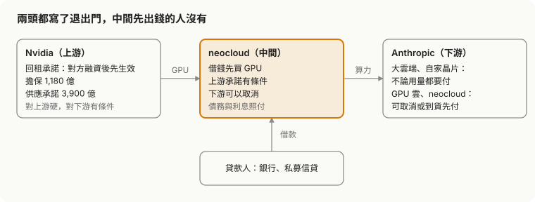

@Mythogen Engine · Nov 20, 2026

## 之前看不到的上游，這一季有了文件

我在[〈同一個產業代碼，兩種相反的動作〉](https://mythogenengine.com/docs/finance/one-industry-code-two-opposite-moves)看台灣半導體業的資本支出時寫過：上撇的擴產，建在一條愈來愈靠借貸、借貸成本又在上升的需求鏈上；那張表只看得到下游的設備進場，看不到鏈條的上游。

後來我在[〈黃仁勳走了，擔保還在〉](https://mythogenengine.com/docs/finance/jensen-huang-is-gone-the-guarantees-remain)再寫了一步：Nvidia 的估值只算了盈利，沒算它替客戶擔保、將來可能要還的錢。

那時兩篇都是從結構推出來的。這一季，兩份公開文件讓這個判斷有了白紙黑字：

- Nvidia 財務長在 11 月 17 日的業績評論裡寫道，不少 neocloud（專門出租 AI 算力的新興雲端公司）和前沿實驗室客戶，增長快過它們的資產負債表和長期信用所能支撐的程度。賣方自己承認，買家的信用跟不上。
- Anthropic 10 月 26 日的招股書，把算力合約分成兩類：對大雲端鎖死承諾，對 GPU 雲和 neocloud 留了退出權。

把兩份文件放在一起讀，風險落在哪裡就很清楚：上游寫了條件，下游留了取消權，夾在中間、借錢買 GPU 的人，兩頭都沒有保障。

（數據表放在文末附錄，正文只寫結構。）

## 上游：Nvidia 的回租承諾，加了一個前提

Nvidia 賣 GPU 給 neocloud，同時簽約把部分算力租回來自用。這份回租合約對 neocloud 很重要：等於一個「保證有客」的承諾，可以拿去向貸款人借錢買機器。

[Carrying Value 在業績公布後已經把這些條款整理得很清楚](https://carryingvalue.substack.com/p/nvidias-quarter-a-first-read-while)，這裡只取跟本文有關的一點：這些承諾只在 neocloud 找到買設備的融資、而 Nvidia 接受了那批容量之後才生效。融資不成，Nvidia 不用付一分錢，只是少了一張訂單。代理行政總裁兼財務長 Colette Kress 說，這是「澄清」，不是「改變」。

就算條款本來就是這樣，選在這個時間點寫清楚，已經是一個訊號。而它的意思是：那份本來幫 neocloud 借到錢的承諾，要等它先借到錢才算數。對最需要這份承諾的小型 neocloud，這是雞與蛋的問題；對 Nvidia，這是一道已經寫好的退出門。

## 下游：Anthropic 對 GPU 雲留了退出權

Anthropic 招股書裡的算力合約，[FourWeekMBA](https://fourweekmba.com/ai-anthropic-holds-exit-rights-in-206b-of-gpu-cloud-deals/) 和 [Fortune](https://fortune.com/2026/10/26/anthropics-s-1-makes-clear-its-on-the-hook-for-billions-in-compute-its-customers-can-walk-at-any-time-2/) 已經逐份拆解過，這裡只取一個分類：

- **鎖死的**：對 Google、Amazon、Microsoft 和 Broadcom 相關的設備租賃，不論用不用都要付，用少了要補差額。
- **可以退的**：經 SpaceXAI 取得的 Nvidia GPU 算力，初期不可取消期一過，提前 90 天通知就可取消；與 Nscale、Lambda 等 neocloud 的合約有終止權，到貨才付費。

招股書對大雲端寫的是「至少」，對 SpaceXAI 寫的是「最多」。一個是下限，一個是上限。

Anthropic 這樣安排有它的道理：招股書也承認，它不少客戶的合約允許減少用量或終止。收入不穩的一方，自然想在成本一方留一道門。問題是這道門開在哪裡：不是開在自家晶片那邊，而是開在 Nvidia GPU 那邊。

## 中間：先出錢的人

neocloud 要先借錢買 GPU，算力交付了才收得到錢；上游的承諾要它先借到錢才生效，下游的合約可以取消。債務和利息，卻沒有任何條件句。

這個位置我很熟悉。我家上一代在香港做工程，遇過一樣的結構：中間的人先出錢，上家不付款，下家要收了貨才結數。上家夠惡、下家夠爛，夾在中間的人極難處理，只能借錢撐下去。帳面有利潤，現金收不回來，最後利大本無歸。

不同的是，香港那一套很多時候是理虧的：拖數、賴數，明明不合規矩，你卻奈他不何。這一次全部寫在合約和公開文件裡。Nvidia 的前提、Anthropic 的取消權，都是公開披露、合法的財技。中間人的處境一樣，區別只是：這一次，連一個「對方理虧」的說法都沒有。

以上市 neocloud 中規模最大的 CoreWeave 為例。它不在 Anthropic 招股書點名的 neocloud 之列，但它的財報最能說明這個位置：營收按年增長超過一倍半，營業上在賺錢，但利息支出比整個淨蝕還大；財務長也表明，在現時的利率下，2027 年前不會再發行母公司層級的無抵押債。對這種公司，上游的回租承諾和下游的長約，是拿去說服貸款人的抵押品。兩頭都加了條件，抵押品就不再那麼硬。

## Nvidia 對下游留了門，對上游卻越鎖越緊

Nvidia 自己也有硬承諾。這一季它的供應承諾一季多了一千多億美元，主要是多年期的記憶體採購，大部分在管理層預期增長最快的 FY2028 到期。增長達標，這是保障供應；增長不達標，它就要揹著用不著的記憶體和零件。壓力也會沿著這些長約傳到記憶體廠，這一點跟我《記憶體與 AI 算力週期》系列接得上。

錢的另一邊，它賺到的錢有相當部分投回了客戶。這一季買入的股權證券，金額剛好填上自由現金流扣除回購和股息之後的餘額；非上市股權的持有量，從 1 月至今大約增至三倍。應收帳款的增長，也快過營收。

這就是「循環融資」在財報上的樣子：賣晶片賺到的錢，一部分變成客戶的股份，客戶拿著這些錢和借來的錢，再回頭買晶片。對上游的承諾是硬的，對下游的承諾是有條件的，這是任何賣方都想要的位置。但如果下游真的借不到錢，Nvidia 少的不只是一張訂單，還有一批已經簽了約的存貨。

各項數字見附錄。

## 誰最後還錢

要還的錢不會平均分配，而是按合約條款，流向沒有退出門的人。如果需求放慢，按各方自己寫的條款，次序大概是：

1. Anthropic 在不可取消期結束後，提前 90 天通知，減少 GPU 雲的算力。
2. neocloud 少了收入，但借來買 GPU 的債務和利息照付。
3. neocloud 找不到新融資，Nvidia 的回租承諾不生效，Nvidia 少了訂單。
4. Nvidia 的供應承諾不會因此減少；在它提供過擔保的項目裡，擔保開始觸發。

這是按條款推出來的次序，不是預測。它會不會發生，取決於需求。但如果發生，最先受傷的不是寫條款的兩頭，而是中間借錢買 GPU 的 neocloud，和借錢給它們的人。

這條鏈有一個具體日子：Anthropic 與 SpaceXAI 的合約，初期不可取消期在 2027 年 1 月及 3 月屆滿。那是第一道退出門可以打開的時候。屆時續約還是減量，會是這個判斷的第一次檢驗。

每季可以對照的訊號，列在附錄。

## 附錄：數據

金額均為美元。

### A. Nvidia（Q3 FY2027，截至 2026 年 10 月 25 日）

| 項目 | 上一季 | 本季 |
| --- | --- | --- |
| 擔保總額 | 1,085 億 | 1,180 億（含新增 95 億電力與系統信用支持；未付過款） |
| neocloud 回租協議 | 360 億 | 320 億 |
| 未開始的數據中心租約 | — | 740 億（租期最長 20 年） |
| 供應承諾 | 2,790 億 | 3,900 億 |
| 其中 FY2028 到期 | 870 億 | 2,030 億 |
| 應收帳款 | — | 810 億（季增 29%，營收季增 20%） |
| 應收天數 | 60 天 | 64 天 |
| 非上市股權持有量 | 223 億（1 月） | 655 億 |

兩個直接客戶分別佔應收 18% 和 17%。非上市股權本季淨蝕 10 億，含 18 億減值。

### B. Nvidia 本季現金去向（筆者粗略拆解）

| 項目 | 金額（億） |
| --- | --- |
| 自由現金流 | +438 |
| 回購股票 | −220 |
| 股息 | −60 |
| 買入股權證券 | −157 |
| 併購及其他 | −27 |

合計約 −26 億，與現金及有價證券由 566 億跌至 535 億大致吻合。精確對帳待 10-Q。

### C. Anthropic 算力合約（公開招股書，2026 年 10 月 26 日）

| 對手 | 金額 | 條款 |
| --- | --- | --- |
| Google | 至少 1,111 億 | 不論用量都要付，用少了要補差額 |
| Amazon | 至少 1,100 億 | 與 Google 類似 |
| Microsoft | 至少 314 億 | 只有對方重大違約而不改正才可取消 |
| Broadcom 相關設備租賃 | 約 1,612 億 | 大部分不可取消 |
| SpaceXAI（Nvidia GPU） | 最多 1,205 億 | 不可取消期至 2027 年 1 月及 3 月；之後 90 天書面通知可取消 |
| Nscale、Lambda | 未逐筆列出 | 有終止權，到貨才付費 |

後來的修訂版招股書用了另一種拆法，數字不可直接對比。

### D. CoreWeave（neocloud 例子，2026 年第三季）

| 項目 | 數字 |
| --- | --- |
| 營收 | 36.61 億（按年 +168%） |
| 未履行合約 | 約 1,325 億 |
| 淨蝕 | 7.09 億 |
| 淨利息支出 | 8.46 億 |
| 債務 | 接近 470 億 |
| 第四季利息指引 | 10.5–11.5 億 |

### E. 每季可以對照的訊號

| 看哪裡 | 訊號 |
| --- | --- |
| Nvidia 擔保 | 總額；第一次出現「已付款」 |
| Nvidia neocloud 回租協議 | 是否繼續縮減 |
| Nvidia 應收 | 應收天數；大客戶集中度 |
| Nvidia 非上市股權 | 減值是否擴大 |
| Nvidia 供應承諾 | 增長是否快過營收指引 |
| neocloud | 利息是否繼續大於營業利潤；新融資的條件 |
| Anthropic | 2027 年 1 月及 3 月後，SpaceXAI 合約續約或減量 |

## 待 10-Q 補充

本文寫成時，Nvidia 這一季的 10-Q 尚未提交（限期為 12 月 4 日）。以下幾項屆時更新：

- 擔保 1,180 億的逐筆明細，包括新增 95 億的對象
- 740 億未開始數據中心租約的條款
- 現金流的精確對帳
- 非上市股權投資的對象是否有披露

## 資料來源

筆者先前文章：

- [〈同一個產業代碼，兩種相反的動作〉](https://mythogenengine.com/docs/finance/one-industry-code-two-opposite-moves)（2026 年 11 月）
- [〈黃仁勳走了，擔保還在〉](https://mythogenengine.com/docs/finance/jensen-huang-is-gone-the-guarantees-remain)（2026 年 11 月）

公開文件及分析：

- Nvidia Q3 FY2027 業績新聞稿及財務長評論（2026 年 11 月 17 日）
- [Nvidia Supplemental Financial Information, Q3 FY2027](https://s201.q4cdn.com/141608511/files/doc_financials/2027/Q327/Supplemental-Financial-Information-NVDA-2027-Q3.pdf)
- [Carrying Value：Nvidia’s Quarter: A First Read, While We Wait for the 10-Q](https://carryingvalue.substack.com/p/nvidias-quarter-a-first-read-while)
- [Global Finance：Nvidia’s Cash Machine Fuels Buybacks, Investments — and Debt](https://gfmag.com/capital-raising-corporate-finance/nvidias-cash-machine-fuels-buybacks-investments-and-debt/)
- [More Than Moore：NVIDIA Q3 FY27: A Record Quarter](https://morethanmoore.substack.com/p/nvidia-q3-fy27-a-record-quarter)
- Anthropic, PBC Form S-1（2026 年 10 月 26 日）
- [FourWeekMBA：Anthropic Holds Exit Rights in $206B of GPU Cloud Deals](https://fourweekmba.com/ai-anthropic-holds-exit-rights-in-206b-of-gpu-cloud-deals/)
- [FourWeekMBA：Anthropic to Pay SpaceXAI Up to $120.5B for Nvidia Compute](https://fourweekmba.com/ai-anthropic-to-pay-spacexai-up-to-120-5b-for-nvidia-compute/)
- [Fortune：Anthropic’s S-1 makes clear it’s on the hook for billions in compute](https://fortune.com/2026/10/26/anthropics-s-1-makes-clear-its-on-the-hook-for-billions-in-compute-its-customers-can-walk-at-any-time-2/)
- [Implicator：Anthropic IPO prospectus, $518 billion compute commitments](https://www.implicator.ai/anthropic-ipo-prospectus-518-billion-compute-commitments/)
- [FinSee：CoreWeave Q3 2026 earnings review](https://finsee.ai/earnings/crwv/2026/q3/en/)
- [WebProNews：CoreWeave lifts its 2026 forecast and rules out new unsecured debt](https://www.webpronews.com/coreweave-q3-2026-earnings-raised-outlook-backlog-unsecured-debt/)
