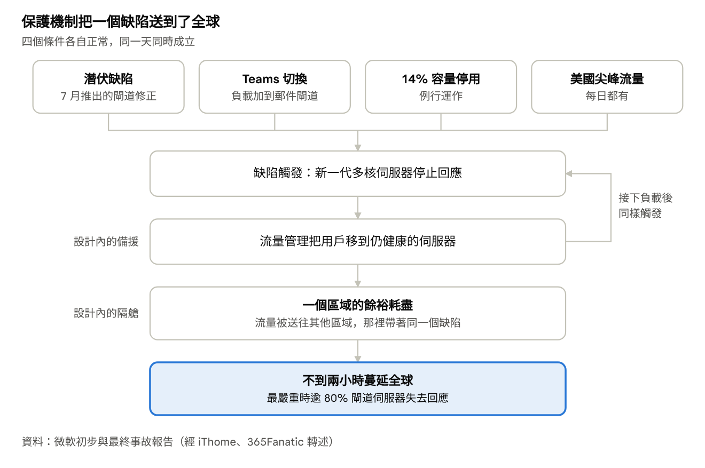
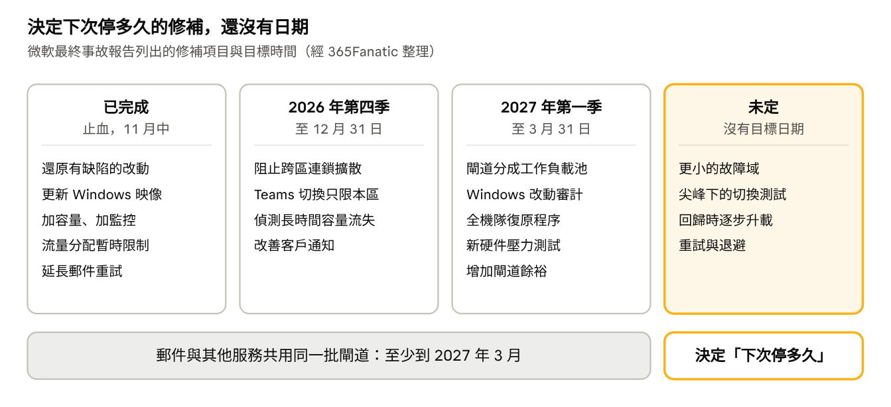
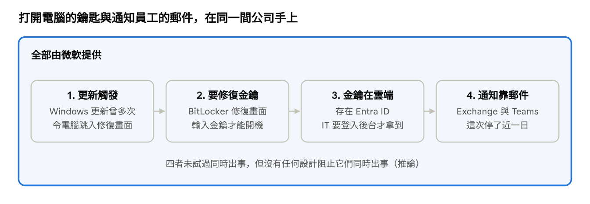

# 微軟 365 停了近一日，修補要到 2027 年：事故報告沒有說的風險

@Mythogen Engine · Nov 26, 2026
微軟的事故報告解釋了一個缺陷怎樣把全球郵件停了近一日。它沒有解釋的部分，和它自己寫下的修補日期，合起來看更重要：把一個缺陷變成全球停機的那幾個機制，大部分要到 2027 年才修，有幾個連日期都沒有。

事故報告發在企業管理員後台，不對公眾公開。本文引用的報告內容，來自媒體與 IT 網站的轉述及外流的初步報告全文，文中會標明。推論的部分也會標明是推論。

## 摘要

- **停了什麼。** 以郵件為首的 Microsoft 365 服務停了 23 小時 50 分。用戶桌上的 Windows 沒有停，病根卻是伺服器端一個 Windows 修正。
- **為什麼停這麼久。** 7 月埋下的缺陷要四個條件同時成立才觸發；備援和隔艙把它送到全球；rollback 退不到三個月前；伺服器一回來就被排隊流量壓垮。
- **報告沒有說的。** 受影響多少客戶、找到瓶頸後六個半小時做了什麼、郵件為什麼沒有後備。
- **還開著的風險。** 修補分到 2026 年第四季與 2027 年第一季；決定「下次停多久」的四項，連日期都沒有。
- **已經有人借事故攻擊。** 用真實事故編號的釣魚郵件、短訊和假 IT 電話；利用這些缺口的方法不止一種，本文只寫類別。
- **中了招也不知道。** 報表靜靜變成舊數、帳密交了給釣魚頁、BitLocker 金鑰在同一個雲端；這些損失沒有人會數。
- **可以對數的預測。** 三條，2027 年 1 至 3 月核對。

| 你想知道 | 讀哪一節 |
| --- | --- |
| 事故經過與原因 | [一](#s1)、[二](#s2) |
| 工程上為什麼救不回 | [三](#s3) |
| 微軟前後說法不一 | [四](#s4) |
| 報告沒說的、風險還開多久（附預測） | [五](#s5)、[六](#s6) |
| 企業要自查什麼 | [七](#s7)、[九](#s9) |
| 攻擊，與為何不寫細節 | [八](#s8) |
| 損失、服務費抵扣、股價 | [十](#s10) |
| 與 Copilot、AI 公司、Ring 0 的關係 | [十一](#s11)、[十二](#s12)、[十三](#s13) |

## 一、停了二十三小時五十分，修了又壞 {#s1}

按微軟事故報告的計法，影響由 11 月 12 日 16:20 UTC 開始，到 13 日 16:10 UTC 結束，共 23 小時 50 分。另有計法把起點定得更早：iThome 引用賓州大學公開的微軟服務健康紀錄，算出 30 小時 5 分。兩個數字不同，分別在於由哪一個故障開始計。

先講清楚一件事：用戶桌上的 Windows 沒有停，電腦照樣開機。停的是雲端那一層：Exchange Online 的郵件、Teams、SharePoint Online、Microsoft 365 Copilot、Defender XDR，其後再加入 Planner、Intune、Purview 和 Power BI。

但病根恰恰是 Windows。微軟的報告指，問題出在一個專為 Microsoft 365 網絡閘道伺服器準備的 Windows 修正。用戶端的 Windows 沒有故障，伺服器端的 Windows 有。

| 時間（UTC） | 台北時間 | 發生什麼 |
| --- | --- | --- |
| 2026 年 7 月 | 7 月 | 有缺陷的閘道修正開始推出，其後運行三個多月沒有可見影響 |
| 11/12 01:07 | 11/12 09:07 | 美東一個路由問題令 Teams 逾時，Teams 切換到與 Exchange Online 共用的閘道 |
| 11/12 16:20 | 11/13 00:20 | Exchange Online 告警，事故 EX1550543 開始 |
| 11/12 18:27 | 11/13 02:27 | 其他受影響服務另開事故 MO1550821 |
| 11/12 19:00 | 11/13 03:00 | 暫停所有部署與設定變更 |
| 11/12 20:00–21:00 | 11/13 04:00–05:00 | 繞過導致健康檢查失敗的元件，發現大批伺服器已失去回應，開始重啟 |
| 11/12 23:55 | 11/13 07:55 | 救回的伺服器一接流量，又再失效 |
| 11/13 00:30–01:00 | 11/13 08:30–09:00 | 確定瓶頸在連線協商 |
| 11/13 07:20 | 11/13 15:20 | 首批容量收到更新，把有缺陷的改動還原 |
| 11/13 11:00 / 11:35 | 11/13 19:00 / 19:35 | 亞太、歐洲先後恢復 |
| 11/13 16:10 | 11/14 00:10 | 影響結束 |
| 11/14 04:15 | 11/14 12:15 | 事故結案 |

時間線取自 [365Fanatic 對最終報告的整理](https://www.365fanatic.com/m365-outage-12-november-2026/)；該頁註明以微軟報告原文為準。起訖時間與[初步報告全文](https://next.ink/wp-content/uploads/2026/11/PostIncidentReport.pdf)一致。另計法見 [iThome](https://www.ithome.com.tw/news/180511)。

## 二、報告說了什麼：四個各自正常的條件，疊在一起 {#s2}

最終報告把根本原因稱為「連線處理中的潛伏缺陷」，並說四個因素重疊，而「每一個因素單獨看都是正常的」。

| 條件 | 內容 | 單獨會不會出事 |
| --- | --- | --- |
| 潛伏缺陷 | 7 月推出的閘道修正，在重負載下令一個 Windows 內部程序的工作互相堵塞（鎖競爭），伺服器停止回應；只在較新、核心數較多的硬件上加劇 | 不會，已運行三個多月 |
| Teams 切換 | Teams 由另一套閘道切到與 Exchange Online 共用的閘道，加重負載、改變流量型態 | 不會，屬設計內的備援 |
| 容量減少 | 約 14% 閘道伺服器容量因例行運作停用 | 不會，餘下容量足夠 |
| 美國尖峰流量 | 每日都有 | 不會 |

四者疊在一起，負載壓到更少的伺服器上，缺陷觸發。流量管理系統照設計把用戶從失效的機器移到健康的機器，健康的機器接下負載，又觸發同一個缺陷。按 [iThome](https://www.ithome.com.tw/news/180549) 轉述的初步報告，不到兩小時便演變成大規模連鎖故障，最嚴重時逾 80% 伺服器失去回應。

閘道本來分成幾千個容量單位，再組成區域，區域之間有隔艙，用來把故障關在一區。初步報告只說隔艙「因另一個問題」失效，沒有解釋。最終報告補上了：一個區域內的餘裕耗盡之後，流量管理把流量送到其他區域，而那些區域帶著同一個缺陷。用來保護服務的機制，把故障送到了全球。

中間兩格是設計內的保護：備援把負載移走，隔艙把流量送到別區。缺陷在每一台機器上，兩個機制就把負載一台接一台地壓過去。

這個缺陷為什麼沒有在測試中被發現，報告也給了答案：壓力測試主要用核心數較少、效能較低的硬件，流量組合也與生產環境不同。測試的那一批機器，剛好是缺陷最不明顯的那一批。

## 三、rollback 為什麼救不回：觀察期擋不住，失守在枱底 {#s3}

做過系統的人，第一個問題通常是：不論是什麼故障，不是應該先 rollback，把服務救回來，再在後面查病根嗎？不論有多少歷史包袱，新版本與上一版總有分別。停一日，不合常理。

報告的答案是：退不到那一版。

- **病根太舊。** 缺陷來自數個月前的改動，平常用來快速撤回的工具（rollback、分批推送、功能開關）都無法迅速逆轉。事故當晚退回的是最近的變更，而病根不在那裡。
- **缺陷遍佈整個機隊。** 三個多月下來，這個修正已經裝在全球的閘道伺服器上，還原要逐個容量單位重新部署。
- **重啟也沒有用。** 伺服器一回到服務，就被排隊中的流量淹沒。微軟的自動復原流程，並不是為這種大範圍失效而設計的。

最後救回服務的做法，正是把那個三個月前的改動還原到先前的版本，即「再退前一版」。時間主要花在前半段：由暫停變更（11/12 19:00 UTC）到首批還原更新（11/13 07:20 UTC），約十二小時，都在重啟、繞過、嘗試修復；找到解法之後，再花約九小時分區域推完。

那麼觀察期呢？一般的做法是改完一樣東西，先讓它穩定運行一段時間，再改下一樣。這次的觀察期有，而且很長：三個多月。但觀察期只能捉到常態下會出現的問題。一個要四個條件同時成立才觸發的缺陷，等多少個月都等不到。

所以這次失守的不是「枱面」，即事故當晚的操作。失守的是「枱底」：測試用錯了硬件，切換測試沒有涵蓋尖峰負載，隔艙設計把故障送到全球。這些都是平時沒有人看得見的地方。

網上另有一種說法，把事故歸咎於資深工程師被趕走。報告沒有證據支持，也沒有否定：出事的改動是今年 7 月的事，指出的缺口在制度與架構，人手與知識流失有沒有影響測試設計，報告沒有談。這一線與[〈怪物變成座位〉](https://mythogenengine.com/docs/chaos-series/the-monster-becomes-a-seat)談的舊系統、與[《混亂去了哪裡》](https://mythogenengine.com/docs/chaos-series)系列相連，另文再寫。

## 四、事故期間的說法，與事後報告不是同一個故事 {#s4}

微軟對事故原因的說法，前後有三個版本。

| 時間 | 來源 | 說法 |
| --- | --- | --- |
| 11 月 12–13 日，事故進行中 | 服務狀態更新 | 找不到與事故起點吻合的近期變更；其後又說開始[回退一項與影響起點吻合的近期網絡設定變更](https://www.epifive.com/blog/microsoft-365-outage-november-2026-root-cause-it-admin-lessons) |
| 11 月 13 日，事故結束時 | 服務狀態最後一則 | 問題[由較早前一次網絡容量升級引入，在最近一次網絡變更後浮現](https://www.on-sitetechnology.com/microsoft-365-outage-november-2026/) |
| 11 月 15 日及 20 日 | 初步與最終事故報告 | 7 月一個閘道 Windows 修正的鎖競爭缺陷，加上 Teams 切換、容量減少、尖峰流量 |

報告沒有把根本原因寫成「容量升級」或「網絡設定變更」。它提到的是美東一個路由問題（引發 Teams 切換）、事故當晚一項針對健康檢查的變更，以及復原期間加裝的容量。狀態頁說的「容量升級」是不是即報告裡的某一項，報告沒有說。

這不一定是隱瞞。事故進行中，工程師先從最近的變更查起，是合理的次序；第一個疑點錯了，是調查的常態。可以說的只有一句：事故期間對外公布的原因，與事後報告的根本原因，不是同一件事。只讀過當時新聞的人，記住的是前一個。

而最終報告本身只發在企業管理員後台。對大部分人來說，第二個故事從來沒有發生。

## 五、報告沒有說的五件事 {#s5}

報告回答了「缺陷怎樣觸發」。下面五件事它沒有回答，每一件都關係到客戶要承擔多少風險。

**一、有多少客戶受影響。** 報告沒有人數、企業數或信箱數。公開的只有 Downdetector 通報，[高峰時逾 13 萬宗](https://www.managertoday.com.tw/articles/view/73332)，那只計主動通報的人。

**二、前半段的時間花在哪裡。** 事故 16:20 UTC 開始，到翌日 00:30–01:00 才確定瓶頸在連線協商，約八小時；再到 07:20 第一批還原更新上線，又是六小時半。找到瓶頸之後，到確定病根是 7 月那個修正、做好還原更新之間發生了什麼，報告沒有說。這是整場事故最長的一段空白。

**三、Exchange 為什麼沒有後備。** 初步報告只說「基於規模原因」。是什麼規模、有沒有計劃讓郵件也能切換，報告沒有說。最終報告的修補清單裡，沒有一項是「讓 Exchange 有後備」，最接近的是 2027 年第一季「把閘道容量分成工作負載池」，即把不同服務的流量分開，不是給郵件一條退路。

**四、7 月那個修正本來要修什麼。** 報告說缺陷來自一個專為閘道準備的 Windows 修正，微軟已把它還原，並更新了 Windows 映像。但那個修正當初為了解決什麼問題、還原之後原問題是否重新打開，報告沒有說。

**五、其他服務的測試是不是一樣。** 報告承認，閘道的壓力測試多用較舊、核心較少的硬件。這是一個測試實驗室的做法問題，報告只談這一套閘道。Entra ID、Intune、Azure 的測試是不是用同一種方法，外人無從得知。

這五件事不一定是刻意不說。事故報告的寫法本來就是「發生了什麼、會修什麼」，不是「客戶還要擔心什麼」。後者要自己推算。

## 六、由修補日期推算：哪些風險還開著 {#s6}

最終報告列出的修補項目有目標日期（按 [365Fanatic 的整理](https://www.365fanatic.com/m365-outage-12-november-2026/)）。反過來讀，它也說明了在那些日期之前，哪些機制仍是老樣子。

已完成的是止血：還原有缺陷的改動、更新 Windows 映像、延長郵件重試窗口、加容量、加監控，以及對自動流量分配加上「暫時」限制。這次的缺陷已經除去。未完成的，是讓下一個缺陷不再變成全球停機的那些機制。

未定的四項，正是這次令故障擴散全球、令復原拖長的那幾個機制。

由這張表可以推算三件事。以下是推論，不是報告的內容。

1. **至少到 2027 年 3 月，郵件仍與其他服務共用同一批閘道容量。** 另一個服務的切換或尖峰，仍可以把負載推到 Exchange 身上。第四季的「把 Teams 切換限於受影響區域」減少了這次的觸發路徑，但不是把兩者分開。
2. **沒有日期的，正是決定「下一次停多久」的那幾項。** 這次缺陷修好之後，還要九小時才分區推完，因為伺服器一上線就被排隊的流量壓垮。逐步升載、准入控制、重試與退避都「未定」。如果在這些完成之前，再有一個潛伏缺陷在全機隊發作，復原會按同一種方式拖長。
3. **測試的盲點與硬件更新的方向一致。** 缺陷在核心數多的新硬件上最嚴重，測試則偏重舊硬件。雲端廠商的資本開支正在大量購入新一代伺服器，機隊裡新硬件的比例只會上升；微軟 9 月底已簽約但未開始的租約達 3,646 億美元（見[〈成本搬去了哪裡〉](https://mythogenengine.com/docs/finance/where-did-the-costs-go)）。同時，微軟兩次延長伺服器可用年限，2023 財年起由 4 年改為 6 年（見[〈改一個估計，多賺幾十億〉](https://mythogenengine.com/docs/finance/change-one-estimate-earn-billions-more)）。舊機用得越久、新機買得越多，機隊裡新舊硬件並存的範圍就越闊，測試要覆蓋的組合也越多。這是推論，報告沒有把測試用舊硬件與年限政策連起來。在最新硬件上擴大測試要到 2027 年第一季，而且只是這一套閘道的承諾。

這些推論可以對數。下面三條都有日期，到期按公開資料核對，錯了照實寫。

| # | 預測 | 對數時間 |
| --- | --- | --- |
| 1 | 微軟不會公開確認第四季各項修補是否如期完成；如有，也只發在企業管理員後台 | 2027 年 1 月 |
| 2 | Microsoft 365 的 2026 年第四季可用率低於 99.9%，是 2013 年有記錄以來第二個低於 99.9% 的季度 | 微軟公布第四季數字時 |
| 3 | 2027 年 3 月底前，一次與這次規模相近、涉及全球多個區域的 Exchange Online 事故不會發生；若發生，復原時間會再次超過十小時 | 2027 年 3 月 |

第 3 條是兩段式：前半預測不會發生，因為這類事故本來少見，而且止血措施已經做了；後半才是本文的判斷：如果發生，不會比這次快很多。

## 七、推估：開啟電腦的鑰匙，也在同一間公司手上 {#s7}

這一節是推估。先列出已公開的事實，再說明推論在哪裡。

很多大公司已在公司電腦上全面啟用 BitLocker 全碟加密（這是我的觀察，沒有公開統計）。平時開機靠電腦內的 TPM 晶片在本機解鎖，不用上網，所以這次斷線沒有把任何人鎖在自己的電腦外。問題在電腦跳進 BitLocker 修復畫面的時候：那時要輸入修復金鑰，而用 Intune 管理的公司，金鑰通常存在微軟的 Entra ID，IT 要在雲端後台才拿得到。

| 已公開的事實 | 出處 |
| --- | --- |
| 微軟自己的更新多次令企業電腦跳進修復畫面：2025 年 5 月、2025 年 10 月、2026 年 4 月 | [Neowin](https://neowin.net/news/microsoft-confirms-pcs-boot-into-bitlocker-recovery-after-the-latest-windows-updates/)、[Petri](https://petri.com/windows-updates-trigger-bitlocker-recovery/)、[BleepingComputer](https://www.bleepingcomputer.com/news/microsoft/microsoft-fixes-bitlocker-recovery-issue-only-for-windows-11-users/amp/) |
| 2026 年 4 月那次，微軟說受影響的設定通常只在企業 IT 管理的系統出現 | [SC Media](https://www.scworld.com/brief/microsoft-addresses-bitlocker-recovery-issue-in-windows-11) |
| 這次斷線，Intune 在受影響名單上；裝置登記、check-in 和合規政策間歇受影響 | [ABC11](https://abc11.com/live-updates/microsoft-outage-live-updates-what-know-outlook-365-other-apps-remain-down/20036817/)、[eCorpIT](https://ecorpit.com/microsoft-365-outage-november-2026-ai-agents/) |
| 2024 年 CrowdStrike 事故，沒有預先管理修復金鑰的機構要逐部電腦人手修復；有機構因大規模停機而拿不到金鑰 | [Directions on Microsoft](https://www.directionsonmicrosoft.com/?p=123931)、[TechTarget](https://www.techtarget.com/searchsecurity/news/366599172/BitLocker-workaround-may-offer-aid-for-CrowdStrike-customers) |
| 只寄到 Exchange Online 信箱的服務健康警報，在 Exchange 停機時收不到 | [Epifive](https://www.epifive.com/blog/microsoft-365-outage-november-2026-root-cause-it-admin-lessons) |

我沒有找到報道說這次 Entra ID 或金鑰讀取停了。所以這次理論上拿得到金鑰，只是沒有人證實。

推論只有一句：觸發修復畫面的更新、保管金鑰的雲端、通知員工的郵件與 Teams，三樣都在同一間公司手上。它們未試過同時出事，但也沒有任何設計阻止它們同時出事。這次的報告就說明了，四個各自正常的條件可以在同一天疊在一起。

平時四個環節各自運作。第一個和第四個同時出事時，第三個就成了唯一的出路。

這類風險沒有數據，因為沒有人有責任去數。微軟的事故報告只計自己的服務停了多久；企業內部有多少部電腦跳進修復畫面、停了多少工時，沒有法例要求披露。損失分散在幾千間公司的 IT 部，每間都當自己倒楣，沒有人會加起來計。

穩妥的做法是把金鑰另備一份在雲端以外，例如本地 AD 或離線匯出，並讓警報有一條不經 Microsoft 365 的通道。這是 IT 管理的細節，沒有人會為做了而被稱讚，所以很多公司不做。

## 八、報告也是一張地圖：已發生的攻擊，與這篇不寫的部分 {#s8}

事故報告寫給客戶看，攻擊者也讀得到。它列出了哪個機制會把小問題變成大停機，也列出了哪些修補還沒有日期。

**已經發生的。** 這次停機不是攻擊造成的，但攻擊者在一天內就拿它來用。微軟威脅情報團隊在 11 月 13 日偵測到[釣魚郵件](https://cybersecuritynews.com/active-password-stealing-attack-microsoft-365/)：冒充 Microsoft 365 服務健康通知，引用真實的事故編號 EX1550543，謊稱停機期間被扣留的郵件會在 24 小時內刪除，要收件人點連結「恢復」。另有資安公司報告，同一個題材也被用在[短訊和假的 IT 支援電話](https://fieldeffect.com/blog/microsoft-365-outage-theme)上。

這一招不需要製造事故，只需要借用一個真的。編號是真的，延誤也是真的，只有「24 小時內刪除」是假的。而正式的服務通知只在管理員後台，一般員工無從核對；平時用來發通知的郵件，又正是停了的那一個。正式的渠道看不到、或停了的時候，假的渠道就最可信。

**不是攻擊，但效果接近的。** 停機期間，大量自動化工具和 AI agent 會不斷重試，把排隊的流量越積越多。有 IT 整理事後建議[為每個 agent 加上退避機制和降級模式](https://ecorpit.com/microsoft-365-outage-november-2026-ai-agents/)。微軟自己的修補清單裡，「改善各服務的重試與退避」是未定日期的一項。AI 用得越多，下一次復原時排隊的流量可能越大。這是推論。

**未擺上檯面的。** 結構上可以利用這次暴露的缺口的方法，不止一種。粗略分，至少有三類：借事故做社交工程（上面已發生的例子）；針對可用性，即設法令大批伺服器同時失效，而復原機制在修好之前仍會按同一方式拖長；以及針對更新與變更流程，7 月那個修正就是在測試中沒有被發現的。有沒有人正在這樣做，外人無從得知。攻擊得手或被擋下，通常都不會公開；「沒有報道」不等於「沒有發生」。

**為什麼這篇不寫細節。** 我做過多年系統與嵌入式工程。讀完這份報告，我想得到不止一種利用這些缺口的做法；我相信讀過報告的工程師，不少也想得到。這篇不寫，不是因為它們不存在，而是寫出步驟對防守的人沒有幫助，只會降低動手的門檻。所以這篇只寫到機制和類別為止。怎樣造出觸發條件、流量有什麼特徵、選什麼時間、用什麼工具，一律不寫。理由很簡單：讀者要知道的是風險在哪裡、自己可以做什麼；攻擊者要知道的是怎樣做。寫結構，對前者有用，對後者沒有增加什麼；寫步驟，則剛好相反。同一個原則也用在[〈機器在台灣，人在香港，公司在新加坡〉](https://mythogenengine.com/docs/notes/machine-taiwan-person-hong-kong)。

讀者可以做的事很少，但都有用：服務通知一律回到管理員後台核對，不點郵件裡的「恢復」連結；警報要有一條不經 Microsoft 365 的通道；BitLocker 金鑰在雲端以外另備一份。

## 九、中了招也不知道：停機留下的「安靜損失」 {#s9}

這次停機最大的風險，可能不是停了一日，而是不少公司已經中招、自己卻不知道。下面三種情況有同一個特徵：出事時沒有錯誤訊息，而本來應該報警的渠道，正是停了的那一條。

| 情況 | 表面看到的 | 實際可能發生的 | 為什麼沒有人發現 |
| --- | --- | --- | --- |
| 報表數據 | Power BI 一直在線，儀表板照常顯示 | 靠電郵附件入數的來源停了更新，刷新「成功」讀到的是舊檔 | 沒有錯誤訊息；真正失敗時，失敗通知也靠電郵寄出 |
| 員工帳號 | 一封看來是官方的「恢復郵件」通知 | 密碼已經交給釣魚頁 | 點過的人不一定自覺或會報告；帳號可以在幾星期後才被用 |
| 公司電腦 | 開機正常 | 如果剛好要 BitLocker 金鑰，可能拿不到 | 這次沒有證實發生，見第七節 |

**報表數據。** Power BI 服務本身[一直在線](https://versich.com/blog/power-bi-microsoft-365-outage/)，但部件在它周圍斷了：帶敏感度標籤的匯出間歇失敗，訂閱和刷新失敗通知延誤，靠電郵附件更新的工作簿變成舊數。最壞的情況不是儀表板壞了，而是它很正常地顯示錯的數字。每日大幅變動的指標變平，或許有人覺得奇怪；月度累計少了兩日，很難看出來。兩日的缺口可以靜靜地進入月報、預算和業績會，到月結對數才被發現，或者永遠不被發現。這正是[〈漂亮圖表下的山頭〉](https://mythogenengine.com/docs/TechNotes/%E6%BC%82%E4%BA%AE%E5%9C%96%E8%A1%A8%E4%B8%8B%E7%9A%84%E5%B1%B1%E9%A0%AD_%E5%B7%A8%E9%A0%AD%E6%93%81%E6%8A%B1%20AI%EF%BC%8C%E9%84%89%E6%B0%91%E9%87%8D%E8%A3%BD%20UI%EF%BC%8C%E6%B2%92%E6%9C%89%E4%BA%BA%E8%82%AF%E4%BA%A4%E5%87%BA%E5%AE%9A%E7%BE%A9%E6%AC%8A)講的事：畫面完整，問題在底下那一層。

**員工帳號。** 第八節的釣魚郵件，目的是[偷 Microsoft 365 帳密](https://www.fortra.com/blog/threat-actors-exploit-microsoft-365-outage-credential-phishing-campaign)。停機當天，員工本來就在等郵件恢復，一封叫他「恢復郵件」的通知，正好就是他想看到的。點了的人未必知道自己中招，知道了也未必報告。帳號被盜，往往要到有人用它做事才會暴露，那可能是幾星期之後，這場停機早已沒有人記得。微軟建議管理員[核對連結並調查有沒有人點過](https://windowsforum.com/news/microsoft-365-phishing-emails-exploit-exchange-outage-ex1550543-with-fake-24-hour-deletion-threat.452450/)，但這要管理員自己去做。

這些損失有多大，沒有數據。微軟的報告只計自己停了多久；保險業的估算只計受保的停工；中了招不知道的，自然不會申報；知道了的，也沒有理由公開。一家公司可以在這次停機裡領了幾個招，自己一個都不知道。

**公司現在可以自查的事：**

1. 把靠電郵入數的報表來源列出來，逐個核對 11 月 12 至 14 日的數據有沒有補上。
2. 在儀表板上直接顯示「數據本身的最新日期」，不只是刷新時間。
3. 檢查停機期間及之後的登入紀錄，問清楚有沒有員工點過「恢復郵件」一類的連結。
4. 數據過期、刷新失敗、服務警報，都要有一條不經 Microsoft 365 的通知渠道。

## 十、損失在客戶那邊，收入在微軟這邊 {#s10}

這次斷線的損失幾乎全部落在客戶身上，微軟最多少收一筆服務費抵扣。

**客戶那邊。** Microsoft 365 的商業付費席位超過 4.5 億個（微軟 2026 年 1 月財報口徑）。已經見報的影響包括：美國媒體業大面積停擺；電動貨車製造商 Workhorse 把原定 11 月 12 日公布的季績延到 16 日；澳洲聯邦警察、情報機構 ASIO 及紐西蘭醫療、法院服務受波及。郵件沒有遺失，微軟把投遞重試窗口由 24 小時延至 48 小時。

損失有多大，沒有人知道。保險業的[模型估算](https://windowsforum.com/news/microsoft-365-outage-why-insured-loss-estimates-range-from-minimal-to-700-million.453526/)區間很闊：Marsh Re 認為市場影響輕微，CyberCube 估低於 1 億美元（保守上限 3.5 億），Morningstar DBRS 估 3 億至 5 億，Kovrr 初步估約 7 億。這些是受保損失的模型數字，不是已申報或已賠付的金額，也不含沒有投保的經濟損失。

**微軟這邊。** 訂閱費是預收的，斷線不會令當季收入消失。合約上的補償是服務費抵扣，[按每月可用率分三級](https://learn.microsoft.com/training/modules/describe-support-offerings-for-microsoft-365-services/3-explain-service-level-agreements)：

| 當月可用率 | 抵扣比例 | 以 11 月（43,200 分鐘）計，全租戶停機超過 |
| --- | --- | --- |
| 低於 99.9% | 25% | 43 分鐘 |
| 低於 99% | 50% | 7.2 小時 |
| 低於 95% | 100% | 36 小時 |

23 小時 50 分約佔 11 月的 3.3%，即可用率約 96.7%，落在 50% 的一級，未到 100%。但這是整個租戶所有用戶都斷足全程的算法。可用率按用戶分鐘逐個租戶計，只有一部分員工受影響的公司，可能只到 25%，甚至一毛都拿不到。抵扣要客戶自己申請，而且只補服務費，不補停工的薪資、延誤的交易和改期的業績會。

**市場這邊。** 事故在美股收市前開始，微軟 11 月 12 日收升 0.36%；同日 Nvidia 宣布黃仁勳辭任，市場注意力不在微軟。第二天盤前一度跌 3%，收市升 0.17%，跑贏同日跌 0.91% 的 Nasdaq。其後 11 月 17 日跌至約七週低位，但報道把跌幅歸咎於市場對 AI 資本開支的疑慮，而不是斷線。

這個結構解釋了客戶為甚麼留下。客戶不是不想走，是一個晚上走不了：二三十年的郵件、文件、權限設定和工作流程都在裡面，斷線當晚唯一能做的事是等。

## 十一、Copilot 跟著一起停，而郵件沒有後備 {#s11}

Microsoft 365 Copilot 從一開始就在受影響服務的名單上，與 Exchange 和 Teams 同時失效。

Copilot 的賣點是替你讀郵件、整理會議、翻查公司文件。這些東西全部住在 Exchange、Teams 和 SharePoint 裡。底下那一層停了，Copilot 就沒有東西可讀。

事故期間有一個疑問：是不是 Copilot 或其他 AI 負載壓垮了伺服器？若是，結論就要由「AI 寄居在舊依賴上」變成「AI 拖垮了舊依賴」。答案是否定的：微軟稱事故[與網絡攻擊或 AI 及 agents 無關](https://windowsforum.com/news/microsoft-365-outage-ex1550543-and-ai-patch-pressure-two-separate-risks-for-admins.453965/)，報告的根本原因也是 Windows 修正。不是 AI 壓垮了系統，是 AI 依附的那一層出事時，AI 沒有自己的退路。

Copilot 的付費席位在 2026 財年第四季超過 3,000 萬個，約佔 4.5 億商業席位的 6.6%。今年初我在[〈微軟的四道緊箍咒〉](https://mythogenengine.com/docs/ai-war/limitations)引用的數字是 1,500 萬個、3.3%，當時論點是 Copilot 分散在各個應用裡、體驗碎裂。席位半年翻倍，地基沒有變。它的銷售方式是在既有席位上加購，客戶是舊客戶，資料是舊資料，連機房也與舊服務同進退。微軟在企業端的 AI 收入，是舊依賴上面加蓋的一層，它沒有另起地基。

報告還透露了另一個細節。Teams、OneDrive、SharePoint 和 Office 應用可以切離出問題的閘道，所以較早恢復；Exchange Online [「基於規模原因」不能切離](https://office-watch.com/2026/microsoft-365-outage-explained/)，所以郵件停得最久。備援設計保護了其他服務，沒有保護到用的人最多、其他服務依賴最深的那一個。而且，正是 Teams 切過來的那一次備援，把 Exchange 推到了觸發缺陷的負載。

## 十二、OpenAI 和 Anthropic 的連接器也斷了：對手的 AI 同樣要經過這一層 {#s12}

同一天，OpenAI 和 Anthropic 各自通報，旗下連接 Microsoft 365 的功能出了問題。Anthropic 在 [12 日 17:52 UTC 報告其 Microsoft 365 連接器錯誤升高](https://www.latintimes.com/microsoft-365-global-outage-outlook-teams-copilot-601369)，稍早於微軟把自己的事故擴大到其他服務。

兩家通報的範圍都限於連接器，沒有提到模型服務本身停擺。斷的是它們伸進企業郵件和文件的那條管道。

這是整件事裡最有資訊量的一個細節。AI 公司要替企業做事，先要讀到企業的資料，而企業的資料住在微軟。模型可以換成任何一家，但對用 Microsoft 365 的企業，管道的另一端只有一個地址。

對微軟，這是一個沒有花錢買的位置。對 OpenAI 和 Anthropic，這代表自家企業產品的可用性，有一部分取決於競爭對手的機房。這兩個結論是同一件事的兩面。

## 十三、回到〈微軟買不到 Ring 0，於是買下 OpenAI〉：驗證了前半，沒有碰到後半 {#s13}

這次事故驗證了[〈微軟買不到 Ring 0，於是買下 OpenAI〉](https://mythogenengine.com/docs/TechNotes/%E5%BE%AE%E8%BB%9F%E8%B2%B7%E4%B8%8D%E5%88%B0%20Ring%200%E6%96%BC%E6%98%AF%E8%B2%B7%E4%B8%8B%20OpenAI)的前半部分，對後半部分沒有提供新證據。

先重述原文的主張。Windows 真正的護城河是幾十萬家第三方寫進去的累積，這種東西不能被建造，只能被等待。微軟在 AI 時代沒有這段歷史，於是改用出資製造依賴，而出資型依賴需要續期。

一個用詞上的說明：Exchange 和 SharePoint 不是處理器意義上的 Ring 0。本文借用這個詞，指同一類東西，即別人花成本寫進去、搬不走的累積。Win32 是程式碼的累積，Microsoft 365 是企業郵件、文件和權限設定的累積。

還有一個反諷。[〈微軟的四道緊箍咒〉](https://mythogenengine.com/docs/ai-war/limitations)寫過 Windows 在 AI 價值鏈上「戰略性過時」：AI 基礎設施跑在 Linux 上。這次停掉全球郵件的，卻是一個 Windows 修正。Windows 在 AI 時代也許沒有新的位置，但它仍然站在微軟自己服務的關鍵路徑上。《大道無形》[第六章](https://mythogenengine.com/docs/AI_TAO/ch06)說 Windows 的護城河是別人寫進去、搬不走的累積；這次證明，搬不走的東西一旦出事，也沒有人走得了。

**驗證了的三點**

1. 舊的累積仍然是真護城河。停機近一日，客戶除了等沒有第二個選項。
2. 微軟自己的 AI 產品沒有獨立的地基，Copilot 與舊服務同沉。
3. 對手的 AI 要進入企業，同樣要經過這一層。

**沒有驗證的兩點**

1. 「出資型依賴需要續期」。這次事故與微軟和 OpenAI 的資本關係無關，兩邊都不能拿它當證據。
2. 微軟的可靠性是否在惡化。事故當日這一點沒有數據，現在有一項：微軟[公布的季度可用率](https://learn.microsoft.com/en-us/office365/servicedescriptions/office-365-platform-service-description/service-health-and-continuity)，2026 年第一季是 99.526%，是 [Office 365 for IT Pros](https://office365itpros.com/2026/04/22/microsoft-365-uptime/) 由 2013 年開始記錄以來最低。但第二季回升到 99.994%，第四季（包括這次事故）未公布。兩個壞季度加一個好季度，仍然不足以稱為趨勢。

**對原文的一點修正**

原文把重心放在買回來的那一層。這次事故提醒的是另一面：微軟在 AI 時代最硬的一張牌不是買的，是舊累積延伸出來的資料層。花錢買的模型層可以替換，沒花錢的資料層替換不了。

這張牌也有背面。依賴越深，每次事故的代價越大。這次的 Exchange 沒有後備，第七節的金鑰也在同一個地方，客戶和監管機構要求分散風險的理由只會更充分。這一點仍是推論。

## 更新紀錄

- 2026 年 11 月 26 日：首次發佈。

## 資料來源

**事故報告與轉述**

- [初步事故報告全文（next.ink 轉載）](https://next.ink/wp-content/uploads/2026/11/PostIncidentReport.pdf)
- [365Fanatic：最終報告整理](https://www.365fanatic.com/m365-outage-12-november-2026/)
- [Office Watch：Microsoft 365 outage explained](https://office-watch.com/2026/microsoft-365-outage-explained/)
- [iThome：初步報告轉述](https://www.ithome.com.tw/news/180549)、[iThome：時長 30 小時的計法](https://www.ithome.com.tw/news/180511)
- [On-Site Technology：狀態頁最後說法](https://www.on-sitetechnology.com/microsoft-365-outage-november-2026/)
- [Epifive：事故期間的狀態更新](https://www.epifive.com/blog/microsoft-365-outage-november-2026-root-cause-it-admin-lessons)
- [WindowsForum：與 AI 無關的說法](https://windowsforum.com/news/microsoft-365-outage-ex1550543-and-ai-patch-pressure-two-separate-risks-for-admins.453965/)

**損失、抵扣與可用率**

- [Microsoft Learn：SLA 抵扣表](https://learn.microsoft.com/training/modules/describe-support-offerings-for-microsoft-365-services/3-explain-service-level-agreements)
- [Microsoft Learn：季度可用率](https://learn.microsoft.com/en-us/office365/servicedescriptions/office-365-platform-service-description/service-health-and-continuity)
- [Office 365 for IT Pros：2026 年第一季可用率](https://office365itpros.com/2026/04/22/microsoft-365-uptime/)
- [WindowsForum：保險業損失估算](https://windowsforum.com/news/microsoft-365-outage-why-insured-loss-estimates-range-from-minimal-to-700-million.453526/)

**連接器與 BitLocker**

- [Latin Times：Anthropic 連接器時間](https://www.latintimes.com/microsoft-365-global-outage-outlook-teams-copilot-601369)
- [ABC11：受影響服務名單](https://abc11.com/live-updates/microsoft-outage-live-updates-what-know-outlook-365-other-apps-remain-down/20036817/)
- [eCorpIT：Intune 受影響範圍](https://ecorpit.com/microsoft-365-outage-november-2026-ai-agents/)
- [Directions on Microsoft：BitLocker Recovery Issues Revealed During CrowdStrike Outage](https://www.directionsonmicrosoft.com/?p=123931)
- [TechTarget：CrowdStrike 與 BitLocker 金鑰](https://www.techtarget.com/searchsecurity/news/366599172/BitLocker-workaround-may-offer-aid-for-CrowdStrike-customers)
- [Neowin：2025 年 5 月更新](https://neowin.net/news/microsoft-confirms-pcs-boot-into-bitlocker-recovery-after-the-latest-windows-updates/)、[Petri：2025 年 10 月更新](https://petri.com/windows-updates-trigger-bitlocker-recovery/)、[BleepingComputer：2026 年 4 月更新](https://www.bleepingcomputer.com/news/microsoft/microsoft-fixes-bitlocker-recovery-issue-only-for-windows-11-users/amp/)、[SC Media](https://www.scworld.com/brief/microsoft-addresses-bitlocker-recovery-issue-in-windows-11)

**借事故的攻擊**

- [Cybersecurity News：微軟警告借停機的釣魚攻擊](https://cybersecuritynews.com/active-password-stealing-attack-microsoft-365/)
- [SecurityWeek：Microsoft Rules Out Cyberattack in Outage, Warns of Phishing Campaign](https://www.securityweek.com/microsoft-rules-out-cyberattack-in-outage-warns-of-phishing-campaign/)
- [Field Effect：短訊與假 IT 支援電話](https://fieldeffect.com/blog/microsoft-365-outage-theme)

**安靜損失**

- [Versich：Power BI and Microsoft 365: What Breaks During a Tenant Outage](https://versich.com/blog/power-bi-microsoft-365-outage/)
- [Fortra：借停機偷取 Microsoft 365 帳密](https://www.fortra.com/blog/threat-actors-exploit-microsoft-365-outage-credential-phishing-campaign)
- [WindowsForum：微軟建議核對連結並調查點擊](https://windowsforum.com/news/microsoft-365-phishing-emails-exploit-exchange-outage-ex1550543-with-fake-24-hour-deletion-threat.452450/)
