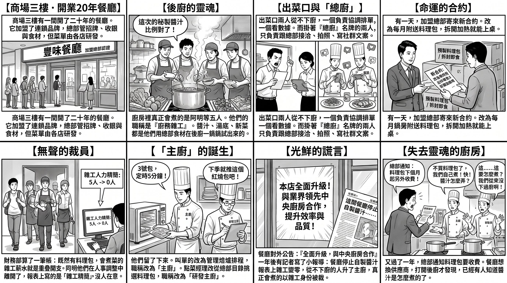
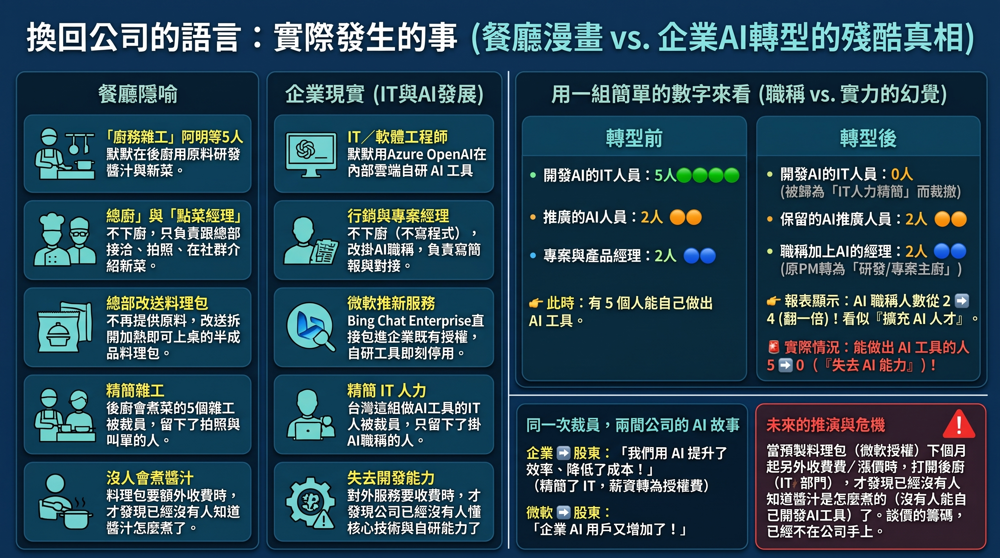

## 王伯達問：你的 AI 換過幾次？

王伯達在[談 Anthropic 上市的影片](https://www.facebook.com/potawang/posts/pfbid02g9Fv8MzTakA3KoMsEUdZxDt4TTBwMcBx9ZiuBbSb2WqV7KCt1jP8BXbNBKsTZgiil)裡，用《鏡中奇遇》的紅皇后比喻模型產業：新模型推出半年，舊模型的營收就只剩不到兩成；客戶大多按用量付費，隨時可以換。所以模型公司只能不停地跑，一邊找新市場，一邊把模型嵌進客戶的工作環境，讓客戶離不開。

影片最後，他問觀眾：「你現在工作用的 AI，換過幾次了？」

這個問題預設了一件事：換不換，是用的人自己決定。新創公司或許如此。但在全公司只用 Microsoft 的大企業裡，員工用的 AI 確實換過，只是不是自己換的；替公司做決定的，也不是公司自己。

我在一間跨國科技公司親眼看過這件事怎麼發生。結論很簡單：**公司對外宣布「配合 AI 發展」，報表上的 AI 人才變多了，但公司自己做 AI 的能力，歸零了。** 先講一個故事。

## 一間餐廳怎樣完成它的「轉型」

商場三樓有一間餐廳，開了二十年。它加盟了一個連鎖品牌，總部管招牌、收銀系統，也供應食材；菜單則由各店自己研發。

廚房裡真正會煮的，是阿明那五個人。他們的職稱是「廚務雜工」，因為當年開這個職位時，沒有人知道研發醬汁應該叫什麼，人事部就隨便填了一個。醬汁、湯底、新菜式，都是他們用總部供應的食材，在後廚一鍋一鍋試出來的。

出菜口還有兩個人，從來不下廚。一個負責叫單、排出菜順序、控制時間，職稱是「樓面協調」；一個負責看點菜數據、建議菜式，職稱是「點菜經理」。

掛著「總廚」名牌的，是兩個負責跟總部接洽、拍照、寫菜單、在社群介紹新菜的人。名牌是前年換的。那一年，「總廚」兩個字很值錢。

有一天，加盟總部寄來新合約：加盟金照舊，但總部不再只供應食材，改為每月附送料理包。醬汁、湯底都是半成品，拆開加熱就能上桌。

財務部算了一筆帳：既然料理包不用另外付錢，後廚會煮菜的那五個雜工，薪水就是重複開支。

阿明他們在下一輪人事調整裡離開了。報表上寫的是「雜工人力精簡」，沒有人注意。

兩位「總廚」留了下來。他們的工作變成跟總部訂料理包、拍照，每週向管理層報告料理包的使用率。使用率每個月都在上升，帶頭的那位升了職。

出菜口那兩個人也留了下來。叫單的人改為管理烤箱排程：哪一包幾點進爐、幾點出爐，職稱改成了「主廚」。點菜經理改為從總部的料理包目錄裡，挑下一季要賣哪幾款。這件事被寫成了「新菜研發」，他的職稱也改成了「研發主廚」。

餐廳對外發了一則公告：「本店全面升級，與業界領先的中央廚房合作，提升出餐效率與品質。」

一年後，有記者寫了一則小報導：這間餐廳停止自製醬汁。報導沒有提到任何人。報表上，雜工從五個變成零，主廚從零變成兩個。從來沒有下過廚的人升了主廚；真正會煮的人，以雜工的身份被裁。

又過了一年，總部通知：料理包下個月起另外收費。

餐廳想過換一家供應商。打開後廚才發現，已經沒有人知道醬汁是怎麼煮的。

## 換回公司的語言：實際發生的事

餐廳是比喻，結構是我親眼看到的。

2023 年上半年，生成式 AI 剛熱起來。公司法務與資安不批准員工直接用公開的 ChatGPT，內部一個團隊就用 Microsoft 的 Azure OpenAI 服務，自己做了一個內部 AI 工具。介面看起來像 ChatGPT，資料留在公司自己的雲端環境裡。台灣在用，美國是主力。

做這件事的人，職稱是 IT。他們入職時，公司還沒有「AI 工程師」這個職位。

另一批人負責內部推廣、教育訓練、寫簡報，向管理層報告「AI 導入進度」。他們的工作本質是行銷，職稱卻陸續改成了 AI 相關的名稱，因為這個名稱在預算會議上比較有份量。

還有一批人是專案經理和產品經理。他們不寫程式，負責排時程、對接需求。這兩年，他們的職稱陸續加上了「AI」；產品經理更常見的做法，是直接改掛研發職稱。

2023 年 7 月，Microsoft 推出 Bing Chat Enterprise，直接包進企業原本就在付費的 Microsoft 365 授權裡，不用另外付錢。內部工具在成本表上，即刻變成重複開支。工具前後只用了半年左右，就停用了。換句話說，同一個供應商，先賣食材讓公司自己煮，再改賣半成品。

接下來的裁員名單裡，有台灣這組做AI工具的IT/SW人。掛 AI 職稱、負責跟 Microsoft 對接的人，留了下來。公司對外公告的說法是「配合 AI 發展」。

用一組簡單的數字來看。以下是示意，不是實際人數。假設轉型前，有 5 個掛 IT 職稱的人在開發 AI，2 個掛 AI 職稱的人在做推廣，另有 2 個專案與產品經理。轉型後，開發的 5 個剩下 0 個；做推廣的 2 個留下，2 個經理的職稱加上了 AI。

報表上，AI 職稱的人數從 2 增加到 4，翻了一倍。被裁的 5 個人，歸在「IT 人力精簡」。但如果問的是「公司裡還有多少人能自己做出 AI 工具」，答案是從 5 變成 0。

**「擴充 AI 人才」與「失去 AI 能力」，可以是同一件事。差別只在於，你數的是職稱，還是工作內容。**

同一次裁員，還可以讓兩間公司各講一個 AI 故事。裁員的公司對股東說，用 AI 提升了效率、降低了成本；Microsoft 對股東說，企業 AI 用戶又增加了。錢的去向則是：從內部薪資，轉成了授權費。

至於故事最後兩段，料理包另外收費、沒有人會煮醬汁，是推演，不是已經發生的事。但它說明了一件已經成立的事：談價的籌碼，已經不在公司手上。

## 為什麼外面看不到

公開資料裡，只會看到「工具停用」，很少看到「團隊被裁」。原因不是沒有人被裁，而是職稱讓這件事從數據裡消失了。

裁員統計、「AI 取代了哪些工作」的研究，全部按職稱分類。一個實際上在做 AI 工具的人，職稱可能是 IT 支援、分析師，或者一個重組之後留下來的舊職位。他被裁，只會是一筆普通的成本削減，不會是新聞。

留下來的人掛著 AI 職稱，公司可以說 AI 團隊沒有縮減，甚至擴充了。兩邊的數字都是真的，只是數的東西不對。

公開報導可以印證前半部。Bloomberg 在 2026 年 1 月報導，[法國興業銀行放棄自己開發的內部 AI 助理 SoGPT，改用 Microsoft Copilot](https://www.bloomberg.com/news/articles/2026-01-12/socgen-turns-to-microsoft-s-copilot-after-scrapping-own-ai-tool)。[另一篇報導](https://emag.directindustry.com/2026/01/16/societe-generale-generative-ai-make-or-buy-microsoft-copilot/)指，銀行當初專門成立了內部團隊開發這個工具。報導寫了工具停用，沒有寫那個團隊之後怎樣。

興業銀行的團隊有沒有被裁，我不知道。但依照上面的結構，就算有，外人也很難看得到。**「工具停用」是公開可見的一半，「團隊被裁」是職稱令它消失的另一半。**

## 這不是新招

Teams 對 Slack 做過的事，Copilot 對企業內部的 AI 團隊再做了一次。

Microsoft 把 Teams 免費包進 Office，企業原本自己選的溝通工具就被擠走。Slack 在 2020 年向歐盟投訴，Microsoft 之後先在歐洲、再在全球，把 Teams 從 Office 拆開銷售。差別只在於，這一次被擠走的不是另一間公司，而是企業自己的員工。員工不會去歐盟投訴。

這也不是 Microsoft 獨有的做法。Google 在 2025 年[把 Gemini 的 AI 功能直接包進 Workspace 的商業方案](https://techcrunch.com/2025/10/09/google-ramps-up-its-ai-in-the-workplace-ambitions-with-gemini-enterprise)，機制完全相同。對以 Workspace 為主的公司，[綑綁會令 Gemini 成為經濟上的預設選擇](https://www.reworked.co/digital-workplace/googles-teams-bridge-could-undercut-its-own-microsoft-exit-strategy/)。誰擁有員工每天上班打開的那套軟體，誰就決定公司用哪個模型。

這就是模型公司「嵌入工作流程」戰略撞到的牆。在這類公司裡，模型公司進得去，多半只是以辦公套件背後的供應商身份進去。客戶關係與定價權，都在套件供應商手上。

## 讀者可以自己核實的三條線索

一個論點如果連「為什麼沒有證據」都解釋了，讀者有理由懷疑它無法驗證。所以這裡留下三條任何人都可以自己查的線索：

1. **時間線**：辦公軟體供應商推出附送的 AI 功能之後，企業內部自建的 AI 工具在幾個月內停用。興業銀行是有名有姓的例子，我見過的是另一個。
2. **履歷**：在 LinkedIn 上找工作經驗寫著「用 Azure OpenAI 建立內部 GPT 工具」、職稱卻是 IT 的人，看他們的離職時間是否與工具停用的時間接近。
3. **職缺**：同一間公司，IT 開發職缺減少的同時，是否出現「AI adoption」「AI enablement」「Copilot 推廣」這類職缺。打開職缺描述來看，工作內容多半是教育訓練、變革管理與內部宣傳。

第三條最直接。它把「做行銷的人掛 AI 職稱」從我的個人觀察，變成任何人都看得到的公開現象。方法只有一個：看職缺描述，不要看職稱。

## 鎖定不只靠技術，也可以靠裁掉懂得離開的人

一般講轉換成本，講的是技術：資料搬不走、系統接不上、流程要重做。這件事顯示的是另一種。

那五個掛 IT 職稱的人，就是公司內部唯一懂得接 API、管權限、將來有能力換模型的人。他們走了之後，公司不是「轉換成本很高」，而是連一個懂得轉換的人都沒有。**把能做替代方案的人裁掉，轉換成本就會自己升高。**

所以，下次看到一間大公司宣布「擴充 AI 人才、配合 AI 發展」，可以問三個問題：被裁的人職稱是什麼，實際在做什麼？留下的 AI 人才，工作內容是開發，還是對接供應商？公司省下的薪資，最後流到了誰的授權費裡？

回到王伯達的紅皇后。模型公司拚命地跑，是為了讓客戶離不開。但在這類公司裡，客戶早就離不開了，只是離不開的不是模型，而是辦公套件。跑得再快的模型，在這裡也只是套件背後可以替換的一個零件。

三個問題問完，誰在門口收錢，就很清楚了。

## Sources

- [SocGen Turns to Microsoft's Copilot After Scrapping Own AI Tool — Bloomberg](https://www.bloomberg.com/news/articles/2026-01-12/socgen-turns-to-microsoft-s-copilot-after-scrapping-own-ai-tool)
- [Société Générale Puts an End to Its Internal AI and Chooses Copilot — DirectIndustry](https://emag.directindustry.com/2026/01/16/societe-generale-generative-ai-make-or-buy-microsoft-copilot/)
- [Google ramps up its AI in the workplace ambitions with Gemini Enterprise — TechCrunch](https://techcrunch.com/2025/10/09/google-ramps-up-its-ai-in-the-workplace-ambitions-with-gemini-enterprise)
- [Google's Teams bridge could undercut its own Microsoft exit strategy — Reworked](https://www.reworked.co/digital-workplace/googles-teams-bridge-could-undercut-its-own-microsoft-exit-strategy/)
- [Anthropic files for Nasdaq IPO — PPC Land](https://ppc.land/anthropic-files-for-nasdaq-ipo-with-16-3bn-in-first-half-revenue/)
