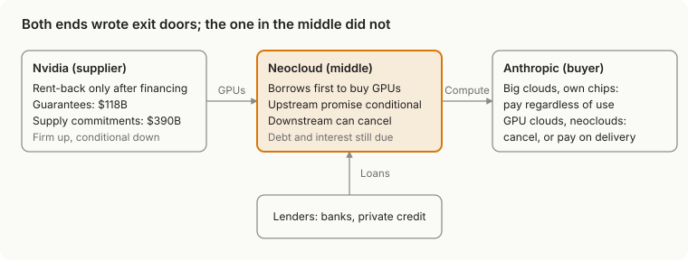

@Mythogen Engine · Nov 20, 2026

## What my earlier table couldn't see now has documents

In [One Industry Code, Two Opposite Moves](https://mythogenengine.com/en/docs/finance/one-industry-code-two-opposite-moves), looking at capital spending across Taiwan's semiconductor sector, I wrote that the expanding half of the K was being built on a demand chain that relied more and more on borrowing, at a rising cost. That table could only see the equipment arriving downstream. It could not see the upstream end of the chain.

In [Jensen Huang Is Gone, the Guarantees Remain](https://mythogenengine.com/en/docs/finance/jensen-huang-is-gone-the-guarantees-remain) I took one more step: Nvidia's valuation counts its earnings, but not the money it has guaranteed for customers and may one day have to pay.

Both pieces were reasoned from structure. This quarter, two public documents put that reasoning in writing:

- In its commentary on November 17, Nvidia's CFO wrote that many neoclouds (new cloud companies that rent out AI compute) and frontier-lab customers are growing faster than their balance sheets and long-term credit can support. The seller itself is saying the buyers' credit is not keeping up.
- Anthropic's S-1 of October 26 splits its compute contracts into two kinds: locked commitments to the big clouds, and exit rights on GPU clouds and neoclouds.

Read together, they make it clear where the risk sits. The supplier wrote conditions, the buyer kept the right to cancel, and the company in the middle, which borrowed to buy the GPUs, is protected at neither end.

(The numbers are in the appendix. The main text covers only the structure.)

## Upstream: Nvidia's rent-back commitments gained a precondition

Nvidia sells GPUs to neoclouds and, at the same time, signs contracts to rent part of that compute back for its own use. For a neocloud, this rent-back contract matters a great deal. It works as a promise of a guaranteed customer, which it can take to lenders to borrow money for the machines.

[Carrying Value has already laid out these terms clearly](https://carryingvalue.substack.com/p/nvidias-quarter-a-first-read-while) since the results came out. Only one point matters here: the commitments take effect only after the neocloud has secured financing for the equipment and Nvidia has accepted the capacity. If the financing falls through, Nvidia pays nothing; it just loses an order. Colette Kress, acting CEO and CFO, called this a clarification, not a change.

Even if the terms were always written this way, spelling them out at this moment is a signal. And what it says is this: the promise that was supposed to help a neocloud borrow only counts once the neocloud has already borrowed. For the small neoclouds that need it most, that is a chicken-and-egg problem. For Nvidia, it is an exit door already built in.

## Downstream: Anthropic kept exit rights on GPU clouds

[FourWeekMBA](https://fourweekmba.com/ai-anthropic-holds-exit-rights-in-206b-of-gpu-cloud-deals/) and [Fortune](https://fortune.com/2026/10/26/anthropics-s-1-makes-clear-its-on-the-hook-for-billions-in-compute-its-customers-can-walk-at-any-time-2/) have already taken the compute contracts in Anthropic's S-1 apart one by one. Only one distinction matters here:

- **Locked in**: Google, Amazon, Microsoft and the Broadcom-related equipment leases must be paid whether or not the capacity is used. Use less, and Anthropic pays the shortfall.
- **Can walk away**: Nvidia GPU compute bought through SpaceXAI can be cancelled on 90 days' notice once an initial non-cancelable period ends. Contracts with neoclouds such as Nscale and Lambda carry termination rights, and Anthropic pays only on delivery.

For the big clouds the S-1 says "at least"; for SpaceXAI it says "up to". One is a floor, the other a ceiling.

Anthropic has its reasons. The S-1 also admits that many of its own customers' contracts allow them to reduce usage or terminate. A company whose revenue can shrink will want a door on the cost side. The question is where that door opens: not on the side of its own custom chips, but on the side of Nvidia GPUs.

## The middle: the one who pays first

A neocloud has to borrow first to buy GPUs, and only gets paid once the compute is delivered. The upstream promise takes effect only after it has borrowed; the downstream contract can be cancelled. Its debt and interest come with no conditions at all.

I know this position well. My family's previous generation ran a contracting business in Hong Kong and lived through the same structure: the one in the middle pays first, the party above doesn't pay, and the party below pays only after receiving the goods. When the one above is hard enough and the one below is bad enough, the one in the middle has almost no way out except to borrow and hold on. The books show a profit, the cash never comes back, and in the end the big margins turn into a total loss.

The difference is that in Hong Kong, the other side was often in the wrong: paying late, refusing to pay, plainly breaking the rules, and there was nothing you could do about it. This time it is all written into contracts and public filings. Nvidia's precondition and Anthropic's right to cancel are disclosed in the open. This is legal financial engineering. The middle party is in the same place; the only difference is that this time, it cannot even say the other side was in the wrong.

Take CoreWeave, the largest listed neocloud. It is not among the neoclouds named in Anthropic's S-1, but its accounts show this position most clearly: revenue up by more than one and a half times year on year, a profit at the operating level, yet interest costs larger than the whole net loss. Its CFO has also said that, at current rates, it will not issue new parent-level unsecured debt before 2027. For a company like this, the upstream rent-back promise and the downstream long-term contract are the collateral it uses to persuade lenders. Once both ends add conditions, that collateral is no longer so firm.

## Nvidia leaves a door downstream but locks itself tighter upstream

Nvidia has hard commitments of its own. This quarter its supply commitments rose by more than $100 billion in a single quarter, mostly multi-year memory purchases, most of them falling due in FY2028, the year management expects the fastest growth. If growth arrives, this secures supply. If it doesn't, Nvidia is left holding memory and parts it cannot use. The pressure will also travel down these long contracts to the memory makers, which connects to my series on memory and the AI compute cycle.

On the other side of the ledger, a good share of the money Nvidia earns goes back into its customers. The equity securities it bought this quarter almost exactly fill what was left of free cash flow after buybacks and dividends. Its holdings of non-marketable equity have roughly tripled since January. Receivables are also growing faster than revenue.

This is what "circular financing" looks like in the accounts: part of the money earned from selling chips becomes shares in customers, and the customers take that money, plus borrowed money, and come back to buy more chips. Commitments upstream are firm; commitments downstream are conditional. That is the position any seller wants. But if the downstream really cannot borrow, Nvidia loses more than an order. It is also left with inventory it has already contracted for.

The figures are in the appendix.

## Who repays last

The money that has to be repaid is not shared evenly. It flows, by the terms of the contracts, to whoever has no exit door. If demand slows, then by each party's own terms the order is roughly:

1. After the non-cancelable period ends, Anthropic gives 90 days' notice and cuts its GPU-cloud compute.
2. The neocloud loses revenue, but still pays the debt and interest it took on to buy the GPUs.
3. The neocloud cannot find new financing, so Nvidia's rent-back commitment never takes effect, and Nvidia loses the order.
4. Nvidia's supply commitments do not shrink because of this; in the projects it has guaranteed, the guarantees start to trigger.

This is an order read from the contract terms, not a forecast. Whether it happens depends on demand. But if it does, the first to be hurt are not the two ends that wrote the terms. They are the neoclouds in the middle that borrowed to buy GPUs, and the people who lent to them.

The chain has a concrete date. The initial non-cancelable periods of Anthropic's contracts with SpaceXAI end in January and March 2027. That is when the first exit door can open. Whether those contracts are renewed or reduced will be the first test of this reading.

The signals to check each quarter are listed in the appendix.

## Appendix: data

All amounts in US dollars.

### A. Nvidia (Q3 FY2027, quarter ended October 25, 2026)

| Item | Prior quarter | This quarter |
| --- | --- | --- |
| Total guarantees | $108.5B | $118.0B (incl. a new $9.5B of power and systems credit support; nothing paid out yet) |
| Neocloud rent-back agreements | $36B | $32B |
| Data-centre leases not yet started | — | $74B (terms up to 20 years) |
| Supply commitments | $279B | $390B |
| of which due in FY2028 | $87B | $203B |
| Accounts receivable | — | $81B (up 29% quarter on quarter; revenue up 20%) |
| Days sales outstanding | 60 | 64 |
| Non-marketable equity holdings | $22.3B (January) | $65.5B |

Two direct customers account for 18% and 17% of receivables. Non-marketable equity posted a net loss of $1.0B this quarter, including $1.8B of impairments.

### B. Where Nvidia's cash went this quarter (author's rough breakdown)

| Item | Amount |
| --- | --- |
| Free cash flow | +$43.8B |
| Share buybacks | −$22.0B |
| Dividends | −$6.0B |
| Purchases of equity securities | −$15.7B |
| Acquisitions and other | −$2.7B |

The total is about −$2.6B, broadly in line with cash and marketable securities falling from $56.6B to $53.5B. An exact reconciliation awaits the 10-Q.

### C. Anthropic's compute contracts (public S-1, October 26, 2026)

| Counterparty | Amount | Terms |
| --- | --- | --- |
| Google | At least $111.1B | Pay regardless of usage; shortfalls made up |
| Amazon | At least $110.0B | Similar to Google |
| Microsoft | At least $31.4B | Cancelable only for an uncured material breach by the other side |
| Broadcom-related equipment leases | About $161.2B | Mostly non-cancelable |
| SpaceXAI (Nvidia GPUs) | Up to $120.5B | Non-cancelable until January and March 2027; cancelable on 90 days' written notice after that |
| Nscale, Lambda | Not itemised | Termination rights; pay on delivery |

A later amended S-1 uses a different breakdown; its figures are not directly comparable.

### D. CoreWeave (neocloud example, Q3 2026)

| Item | Figure |
| --- | --- |
| Revenue | $3.66B (up 168% year on year) |
| Remaining performance obligations | About $132.5B |
| Net loss | $709M |
| Net interest expense | $846M |
| Debt | Close to $47B |
| Q4 interest guidance | $1.05–1.15B |

### E. Signals to check each quarter

| Where to look | Signal |
| --- | --- |
| Nvidia guarantees | Total; the first appearance of any amount paid |
| Nvidia neocloud rent-back agreements | Whether they keep shrinking |
| Nvidia receivables | Days outstanding; concentration in large customers |
| Nvidia non-marketable equity | Whether impairments grow |
| Nvidia supply commitments | Whether they grow faster than revenue guidance |
| Neoclouds | Whether interest stays larger than operating profit; terms of new financing |
| Anthropic | After January and March 2027, whether the SpaceXAI contracts are renewed or reduced |

## Pending the 10-Q

At the time of writing, Nvidia had not yet filed its 10-Q for this quarter (due December 4). The following will be updated then:

- A line-by-line breakdown of the $118.0B in guarantees, including who the new $9.5B covers
- The terms of the $74B in data-centre leases not yet started
- An exact reconciliation of cash flow
- Whether the targets of its non-marketable equity investments are disclosed

## Sources

The author's earlier pieces:

- [One Industry Code, Two Opposite Moves](https://mythogenengine.com/en/docs/finance/one-industry-code-two-opposite-moves) (November 2026)
- [Jensen Huang Is Gone, the Guarantees Remain](https://mythogenengine.com/en/docs/finance/jensen-huang-is-gone-the-guarantees-remain) (November 2026)

Public filings and analysis:

- Nvidia Q3 FY2027 press release and CFO commentary (November 17, 2026)
- [Nvidia Supplemental Financial Information, Q3 FY2027](https://s201.q4cdn.com/141608511/files/doc_financials/2027/Q327/Supplemental-Financial-Information-NVDA-2027-Q3.pdf)
- [Carrying Value: Nvidia’s Quarter: A First Read, While We Wait for the 10-Q](https://carryingvalue.substack.com/p/nvidias-quarter-a-first-read-while)
- [Global Finance: Nvidia’s Cash Machine Fuels Buybacks, Investments — and Debt](https://gfmag.com/capital-raising-corporate-finance/nvidias-cash-machine-fuels-buybacks-investments-and-debt/)
- [More Than Moore: NVIDIA Q3 FY27: A Record Quarter](https://morethanmoore.substack.com/p/nvidia-q3-fy27-a-record-quarter)
- Anthropic, PBC Form S-1 (October 26, 2026)
- [FourWeekMBA: Anthropic Holds Exit Rights in $206B of GPU Cloud Deals](https://fourweekmba.com/ai-anthropic-holds-exit-rights-in-206b-of-gpu-cloud-deals/)
- [FourWeekMBA: Anthropic to Pay SpaceXAI Up to $120.5B for Nvidia Compute](https://fourweekmba.com/ai-anthropic-to-pay-spacexai-up-to-120-5b-for-nvidia-compute/)
- [Fortune: Anthropic’s S-1 makes clear it’s on the hook for billions in compute](https://fortune.com/2026/10/26/anthropics-s-1-makes-clear-its-on-the-hook-for-billions-in-compute-its-customers-can-walk-at-any-time-2/)
- [Implicator: Anthropic IPO prospectus, $518 billion compute commitments](https://www.implicator.ai/anthropic-ipo-prospectus-518-billion-compute-commitments/)
- [FinSee: CoreWeave Q3 2026 earnings review](https://finsee.ai/earnings/crwv/2026/q3/en/)
- [WebProNews: CoreWeave lifts its 2026 forecast and rules out new unsecured debt](https://www.webpronews.com/coreweave-q3-2026-earnings-raised-outlook-backlog-unsecured-debt/)
