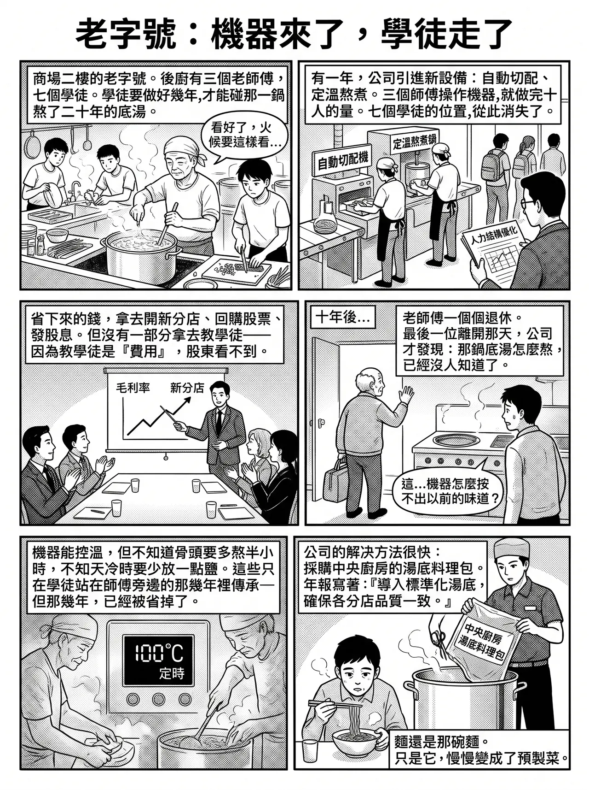
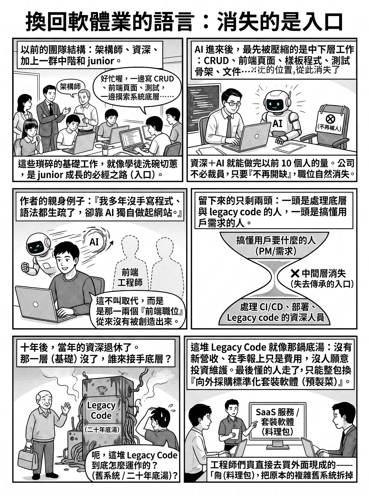

import posterImg from './img/apprentice-gone-poster.webp';

## One prompt can't build a product. Three people can.

<video src="/video/apprentice-gone.mp4" poster={posterImg} controls muted playsInline preload="metadata" width="100%" />

I recently came across a very typical argument under a post in a tech community. The post said: if anyone tells you your product can be replaced by a single prompt, don't believe it. All you lose is the money of the tiny minority who would build it themselves anyway. The engineers in the comments agreed. CI/CD, code signing, self-hosted runners: any one of these is enough to wear you down. What product can a single prompt finish?

They're right. Someone who can't code won't build a large, complete product that can be maintained for years.

But both sides of this argument are standing too far out. One side says AI will replace everything; the other says AI can't replace anything. What is actually happening sits in the middle, and few people want to say it: **the product doesn't have to disappear for the people to disappear.**

An experienced engineer working with AI can now finish what a whole team used to do. The product is still there, users still pay, and what disappears are the positions that would otherwise have been filled.

In "[The People Who Built AI Were Laid Off, the People Who Promoted It Stayed](/docs/notes/ai-title-game)", I wrote about a restaurant on the third floor of a shopping mall. This time, it's another shop in the same mall.

## The old noodle house on the second floor: the machines came, the apprentices left

On the second floor of the mall there is an old noodle house that sells one thing: a bowl of noodle soup.

It opened before the restaurant on the third floor. Later it became a chain and went public. The kitchen at the flagship had ten people: three master cooks and seven apprentices. The apprentices started by washing bowls and chopping spring onions. Only after a few years did they get to touch the stock that had been simmering for twenty years.

One year, head office brought in new equipment: automatic cutters, temperature-controlled stock pots, an order system. With the machines, the three master cooks could handle what ten people used to.

The noodles were the same, and customers still queued. Finance's report looked great: labour costs down, gross margin at a record high.

The seven apprentice positions vanished from the next year's headcount plan. No one was laid off; the positions just weren't filled again. Nobody was fired on paper. The report simply said "workforce structure optimised".

Where did the money saved go?

Some of it went into new branches. The fit-out and equipment of a new branch go into the annual report. They are assets, and they make an expansion story to tell shareholders.

Some of it went into share buybacks and dividends. The share price rose, and management's bonuses rose with it.

None of it went into training apprentices. Training is an expense, deducted from that year's profit. An apprentice you train might be poached by the shop across the corridor three years later. Shareholders can't see the return on that investment, and management can't wait long enough for it.

Ten years went by like this.

The master cooks retired one by one. On the day the last one left, the company discovered that no one knew how to make the stock.

The machines could control temperature and keep time. They didn't know which batch of bones needed another half hour, or that you use a little less salt when the weather turns cold. None of this had ever been written down. It was passed on only in the years an apprentice stood next to a master at the stove.

And those years had been cut.

The company's fix came quickly: buy ready-made stock packs from a central kitchen, the same kind the third-floor restaurant ended up using. The annual report read: "Introduced standardised soup base to ensure consistent quality across all branches."

The noodles are still the same bowl of noodles. It's just that, from the inside, they have slowly turned into a ready meal.

## Back in software terms: what disappears is the entry point

The noodle house is a metaphor. The structure is what is happening in software right now.

A software team used to look roughly like this: one architect, a few seniors, and a layer of mid-level and junior engineers. When AI arrived, the first work to be compressed was the middle and lower layers: CRUD, front-end pages, boilerplate, test scaffolding, documentation.

This work used to belong to juniors, and it was also where juniors learned. In the years they spent writing it, they gradually found their way down to how the system really worked. Just as an apprentice starts with spring onions and only reaches the stock years later.

Now that layer is done by senior engineers with AI. A team of ten becomes a team of three, and the product still ships. The company doesn't need to lay anyone off; it just stops opening positions. Layoffs are visible. Positions that were never opened are not, and no statistic records them.

I'm an example myself. I haven't hand-written code in years, and my syntax has gone rusty, yet with AI I built my own website. Ten years ago, that workload would have meant hiring one or two front-end developers. I didn't replace anyone. The position simply never came into existence.

What remains are the two ends. At one end are the people who handle the foundations: CI/CD, signing, deployment, and the legacy code nobody dares touch. At the other end are the people who work out what users actually want.

The problem comes ten years from now. Today's senior engineers all climbed up through that middle layer. With the layer gone, who takes over the foundations?

The legacy code is the same. Cleaning it up brings no new revenue and no demo; on the quarterly report it is only a cost, so nobody pays for it. It's like that pot of stock: once the people who understand it retire, the only option is to replace the whole thing with a pack.

## Why money flows to machines, not people

Many people say listed companies have no foresight and don't invest in the future. That's only half true. Over the past few years, tech companies have poured astronomical sums into AI capital spending, building GPUs and data centres batch after batch, all with money the market gave them.

The question isn't whether they invest. It's that the stock market chooses **which future gets the investment**.

The market rewards investment that becomes an asset and can be told as a story. GPUs and data centres are capitalised in the accounts and depreciated over years, so the current quarter's earnings per share don't take the whole hit. They can also be pitched to investors: we lead in AI.

The market punishes money invested in people. Hiring juniors, training, cleaning up legacy code: all of it is a current expense that lowers earnings directly, and none of it makes a story. Training is even worse: once trained, people can leave for a competitor, and the return goes to someone else.

Add three mechanisms on top:

- **Quarterly reporting** turns management's unit of time into three months.
- **Executive tenure** lasts a few years, with pay tied to the share price and stock options. An investment that takes ten years to pay back will be harvested long after they've gone.
- **Buybacks** are the fastest way to return money to shareholders. They lift the share price immediately, which is safer than putting the money somewhere with no visible return.

But don't put all the blame on being listed. My family's business back in the day was never listed, and it went the same way: profits on paper, cash it couldn't collect, borrowing to keep going until the end. Private equity is even more short-sighted than listed companies: buy, break up, sell, done in one cut.

The more fundamental rule is this: **if the person making the decision has a shorter time horizon than the investment's payback period, they won't make it.** The stock market simply shortens that horizon systematically, so that short-sightedness becomes the rational choice. The management of the second-floor noodle house weren't stupid. They just couldn't wait for the day the apprentices were ready.

## The efficiency law I used to believe, and where it breaks

For the past fifteen or twenty years, I worked on automation myself, and I believed in an economic law: there's no reason to hold back the progress of a whole society to protect some people's jobs. The money earned from higher efficiency can be used to look after the people who were replaced. And there's no need to feel guilty about earning more.

That law has one precondition: **the money flows back.**

This is how the internet and automation were supposed to work: save labour, produce extra value, then use that value to meet demand that hasn't been met yet. New industries appear, new jobs appear, things get cheaper, and more people can afford a car or a home. On the whole, more people should end up better off.

But look at a bowl of fish ball noodles from a street stall. It hasn't got cheaper because of efficiency. If anything it costs several times what it used to, and the quality is worse. Companies earn more, and the world has printed more money, but that money hasn't turned into wages.

Put it back in the second-floor noodle house, and the loop is clear:

1. Efficiency rises, and labour costs fall.
2. The savings become profit, and profit becomes buybacks, dividends and assets that can go on the books.
3. Asset prices rise, and those who hold assets benefit first.
4. Wages don't rise, prices still do, and ordinary people can spend less.
5. With no new demand, the company cuts costs and automates again, back to step one.

Efficiency itself isn't the problem. What breaks is step two: the money stays in assets and doesn't flow back to create new demand. If it never reaches the people who bore the losses, what efficiency brings isn't progress. It's people turning on each other.

## Investing in the machines' future, not people's

So, back to the argument at the start: can a product be replaced by a single prompt? No. But that's the wrong question.

The right question is: when the same product needs fewer people, where does the money saved go?

The answer is machines, assets and shareholders. The money does go back into investing in the future. It's just the machines' future, not people's.

The second-floor noodle house won't close. It will keep opening branches, keep paying dividends, and its annual reports will keep looking good. All it loses is the stock, and a whole generation of apprentices who never got the chance to stand at the stove.

Layoffs make the news. Positions that were never opened don't. What breaks isn't one job. It's a generation's way in.
