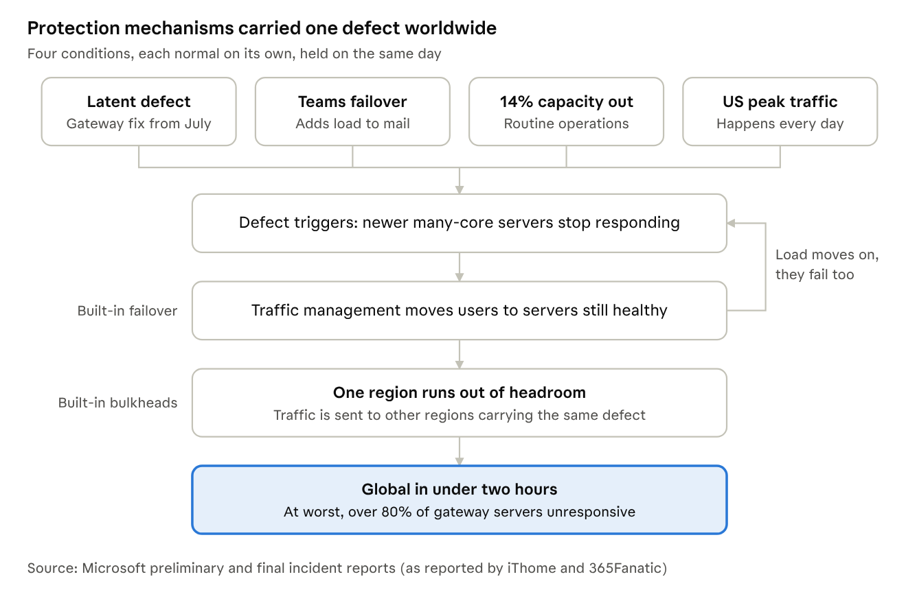
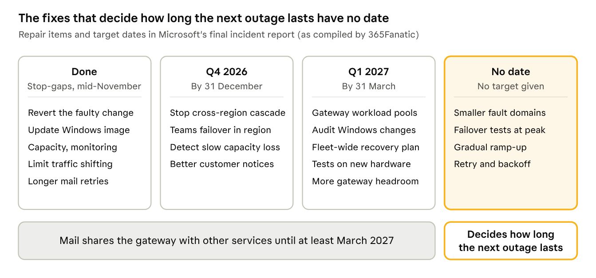
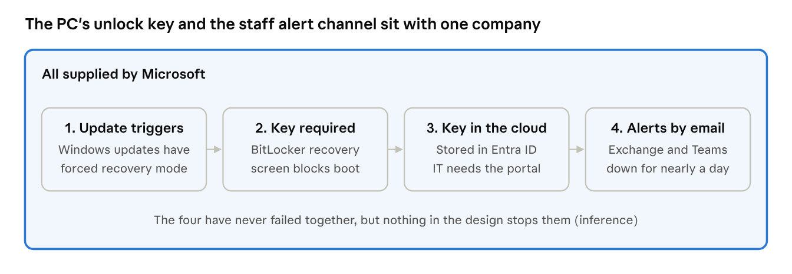

# Microsoft 365 Was Down for Nearly a Day, and the Fixes Run Into 2027: The Risks the Incident Report Leaves Out

@Mythogen Engine · Nov 26, 2026
Microsoft's incident report explains how one defect took the world's email down for nearly a day. Read together with the repair dates Microsoft wrote down itself, what the report does not explain matters more: most of the mechanisms that turned one defect into a global outage will not be fixed until 2027, and several have no date at all.

The incident report was posted to enterprise admin centres and is not public. The report content cited here comes from media and IT-site accounts and a leaked copy of the preliminary report, and is labelled as such. Inferences are labelled as inferences.

## Summary

- **What went down.** Microsoft 365, led by email, was down for 23 hours 50 minutes. Windows on users' desks kept running; the root cause was a Windows fix on the servers.
- **Why it lasted so long.** A defect planted in July needed four conditions at once to trigger. Failover and bulkheads carried it worldwide. Rollback could not reach a change three months old. Servers were crushed by queued traffic the moment they came back.
- **What the report does not say.** How many customers were hit, what happened in the six and a half hours after the bottleneck was found, and why email had no fallback.
- **Risks still open.** Fixes are scheduled for Q4 2026 and Q1 2027; the four items that decide how long the next outage lasts have no date.
- **Attackers already used it.** Phishing emails quoting the real incident ID, text messages, fake IT support calls. There is more than one way to exploit these gaps; this piece names only the categories.
- **Hit without knowing it.** Reports quietly going stale, passwords handed to phishing pages, BitLocker keys in the same cloud. Nobody counts these losses.
- **Predictions you can check.** Three, to be checked between January and March 2027.

| If you want to know | Read section |
| --- | --- |
| What happened and why | [1](#s1), [2](#s2) |
| Why engineering could not save it sooner | [3](#s3) |
| How Microsoft's account changed | [4](#s4) |
| What the report leaves out, and how long the risks stay open (with predictions) | [5](#s5), [6](#s6) |
| What companies should check | [7](#s7), [9](#s9) |
| Attacks, and why this piece gives no details | [8](#s8) |
| Losses, service credits, share price | [10](#s10) |
| Copilot, AI companies and Ring 0 | [11](#s11), [12](#s12), [13](#s13) |

## 1. Down for 23 hours 50 minutes, fixed and broken again {#s1}

By Microsoft's count in the incident report, impact ran from 16:20 UTC on 12 November to 16:10 UTC on 13 November: 23 hours 50 minutes. Another count starts earlier: iThome, citing the University of Pennsylvania's public record of Microsoft service health, puts it at 30 hours 5 minutes. The two figures differ in which failure they start from.

One thing first: Windows on users' desks did not stop, and PCs booted as normal. What stopped was the cloud layer: Exchange Online mail, Teams, SharePoint Online, Microsoft 365 Copilot and Defender XDR, later joined by Planner, Intune, Purview and Power BI.

Yet the root cause was Windows. Microsoft's report traces the problem to a Windows fix prepared specifically for the Microsoft 365 networking gateway servers. Windows on the client side had no fault; Windows on the server side did.

| Time (UTC) | Taipei time | What happened |
| --- | --- | --- |
| July 2026 | July | The defective gateway fix begins rolling out, then runs for more than three months with no visible impact |
| 12 Nov 01:07 | 12 Nov 09:07 | A routing issue in US East causes Teams timeouts; Teams fails over to the gateway it shares with Exchange Online |
| 12 Nov 16:20 | 13 Nov 00:20 | Exchange Online alert; incident EX1550543 begins |
| 12 Nov 18:27 | 13 Nov 02:27 | Incident MO1550821 opened for other affected services |
| 12 Nov 19:00 | 13 Nov 03:00 | All deployments and configuration changes paused |
| 12 Nov 20:00–21:00 | 13 Nov 04:00–05:00 | Components causing failed health checks bypassed; many servers found unresponsive; restarts begin |
| 12 Nov 23:55 | 13 Nov 07:55 | Recovered servers fail again once they take traffic |
| 13 Nov 00:30–01:00 | 13 Nov 08:30–09:00 | Bottleneck identified in connection negotiation |
| 13 Nov 07:20 | 13 Nov 15:20 | First capacity receives an update reverting the defective change |
| 13 Nov 11:00 / 11:35 | 13 Nov 19:00 / 19:35 | Asia Pacific, then Europe, recover |
| 13 Nov 16:10 | 14 Nov 00:10 | Impact ends |
| 14 Nov 04:15 | 14 Nov 12:15 | Incident closed |

Timeline from [365Fanatic's summary of the final report](https://www.365fanatic.com/m365-outage-12-november-2026/); the page notes that Microsoft's own report is authoritative. Start and end times match the [full preliminary report](https://next.ink/wp-content/uploads/2026/11/PostIncidentReport.pdf). For the alternative count, see [iThome](https://www.ithome.com.tw/news/180511).

## 2. What the report says: four conditions, each normal on its own, stacked together {#s2}

The final report calls the root cause "a latent defect in connection processing" and says four factors overlapped, each of them normal on its own.

| Condition | What it was | Would it cause trouble alone? |
| --- | --- | --- |
| Latent defect | A gateway fix rolled out from July made tasks in an internal Windows process block each other under heavy load (lock contention), so servers stopped responding; worse on newer, higher-core hardware | No: it had run for over three months |
| Teams failover | Teams moved from the other gateway to the one it shares with Exchange Online, adding load and changing traffic patterns | No: failover is designed in |
| Reduced capacity | About 14% of gateway server capacity was out of service as part of routine operations | No: enough spare capacity remained |
| US peak traffic | Happens every day | No |

With all four at once, load was squeezed onto fewer servers and the defect triggered. Traffic management did what it was designed to do and moved users from failed machines to healthy ones; the healthy machines took the load and hit the same defect. According to the preliminary report as reported by [iThome](https://www.ithome.com.tw/news/180549), it became a large-scale cascading failure in under two hours, with more than 80% of servers unresponsive at worst.

The gateway is split into thousands of capacity units, grouped into regions, with bulkheads between regions meant to keep a failure in one place. The preliminary report said only that the bulkheads failed "due to a separate issue". The final report filled this in: once one region's headroom was used up, traffic management sent the traffic to other regions, which carried the same defect. The mechanism meant to protect the service carried the failure around the world.

The two middle steps are built-in protection: failover moves load away, bulkheads send traffic elsewhere. With the defect on every machine, both mechanisms simply pushed the load from one machine to the next.

The report also explains why testing missed it: load tests ran mainly on weaker hardware with fewer cores, with a traffic mix different from production. The machines under test were exactly the ones where the defect showed least.

## 3. Why rollback could not save it: the observation period could not catch it, and the failure was below the table {#s3}

Anyone who has run systems asks the same first question: whatever the failure, shouldn't you roll back first, restore service, and hunt for the root cause behind the scenes? However much legacy there is, the new version always differs from the previous one. A day-long outage does not make sense.

The report's answer: the version that needed reverting was out of reach.

- **The root cause was too old.** The defect came from a change made months earlier, and the usual quick-reversal tools (rollback, staged rollout, feature flags) could not undo it fast. What was rolled back on the night was the most recent change, and the cause was not there.
- **The defect was across the whole fleet.** After three months, the fix was on gateway servers worldwide; reverting it meant redeploying capacity unit by capacity unit.
- **Restarting did not help.** Servers returning to service were swamped by queued traffic at once. Microsoft's automated recovery was not designed for failure on this scale.

What finally restored service was reverting that three-month-old change to its earlier version: rolling back one version further. Most of the time went on the first half. From pausing changes (19:00 UTC on 12 Nov) to the first reverting update (07:20 UTC on 13 Nov) was about twelve hours of restarting, bypassing and attempted repair; once the fix was found, rolling it out region by region took about nine more.

What about an observation period? Normal practice is to change one thing, let it run stably for a while, then change the next. This time there was an observation period, and a long one: three months. But an observation period only catches problems that appear under normal conditions. A defect that needs four conditions at once will not show however many months you wait.

So what failed was not "on the table", the operations on the night. What failed was "below the table": tests on the wrong hardware, failover tests that did not cover peak load, a bulkhead design that sent the failure worldwide. These are the places nobody normally sees.

Online, some blame the outage on senior engineers being pushed out. The report neither supports nor refutes it: the faulty change dates from July this year, and the gaps it names are in process and architecture. Whether loss of people and knowledge affected test design, the report does not discuss. That thread connects to ["The Monster Becomes a Seat"](https://mythogenengine.com/en/docs/chaos-series/the-monster-becomes-a-seat) and the legacy systems in the [*Where Did the Chaos Go*](https://mythogenengine.com/en/docs/chaos-series) series, and will be a separate piece.

## 4. What Microsoft said during the incident is not the same story as the report {#s4}

Microsoft's account of the cause came in three versions.

| When | Source | What it said |
| --- | --- | --- |
| 12–13 Nov, during the incident | Service status updates | No recent change matched the start of impact; later, it began [reverting a recent network configuration change that correlated with the start of impact](https://www.epifive.com/blog/microsoft-365-outage-november-2026-root-cause-it-admin-lessons) |
| 13 Nov, at the end of the incident | Final status update | The issue [came from an earlier network capacity upgrade and surfaced after a recent network change](https://www.on-sitetechnology.com/microsoft-365-outage-november-2026/) |
| 15 and 20 Nov | Preliminary and final incident reports | A lock-contention defect in a July Windows fix for the gateway, plus Teams failover, reduced capacity and peak traffic |

The report does not name a "capacity upgrade" or a "network configuration change" as the root cause. It mentions a routing issue in US East (which triggered the Teams failover), a change aimed at health checks on the night, and capacity added during recovery. Whether the status page's "capacity upgrade" is one of these, the report does not say.

This is not necessarily concealment. Mid-incident, engineers start with the most recent changes, which is a sensible order; a first suspect turning out wrong is normal in any investigation. All that can be said is this: the cause given to the public during the incident and the root cause in the report are not the same thing. People who only read the news at the time remember the first.

And the final report itself was posted only to admin centres. For most people, the second story never happened.

## 5. Five things the report does not say {#s5}

The report answers "how the defect was triggered". It does not answer the five questions below, and each bears on how much risk customers carry.

**1. How many customers were affected.** The report gives no count of people, companies or mailboxes. The only public figure is Downdetector reports, [over 130,000 at peak](https://www.managertoday.com.tw/articles/view/73332), and that counts only people who chose to report.

**2. Where the first half of the time went.** The incident began at 16:20 UTC; the bottleneck in connection negotiation was identified only at 00:30–01:00 the next day, about eight hours later. The first reverting update went out at 07:20, another six and a half hours. What happened between finding the bottleneck and confirming that the July fix was the cause and building the revert, the report does not say. It is the longest gap in the whole incident.

**3. Why Exchange has no fallback.** The preliminary report says only "for scale reasons". What scale, and whether there is a plan to let mail fail over too, it does not say. None of the final report's repair items is "give Exchange a fallback"; the nearest is "partition gateway capacity into workload pools" in Q1 2027, which separates different services' traffic rather than giving mail a way out.

**4. What the July fix was meant to fix.** The report says the defect came from a Windows fix prepared for the gateway; Microsoft has reverted it and updated the Windows image. What problem that fix originally solved, and whether reverting it reopens that problem, the report does not say.

**5. Whether other services test the same way.** The report admits that gateway load tests mostly ran on older, lower-core hardware. That is a test-lab practice, and the report covers only this gateway. Whether Entra ID, Intune or Azure are tested the same way, outsiders cannot know.

These five gaps are not necessarily deliberate. An incident report is written as "what happened and what we will fix", not "what customers should still worry about". The latter you have to work out yourself.

## 6. Reading the fix dates: which risks are still open {#s6}

The final report gives target dates for its repair items (per [365Fanatic's summary](https://www.365fanatic.com/m365-outage-12-november-2026/)). Read the other way round, it also tells you which mechanisms stay as they were until those dates.

What has been done is the stop-gap: revert the faulty change, update the Windows image, lengthen the mail retry window, add capacity, add monitoring, and put "temporary" limits on automatic traffic shifting. This particular defect is gone. What is not done are the mechanisms that would stop the next defect from becoming a global outage.

The four undated items are exactly the mechanisms that let this failure spread worldwide and let recovery drag on.

Three things follow from this table. These are inferences, not the report's contents.

1. **Until at least March 2027, mail still shares the same gateway capacity with other services.** A failover or spike in another service can still push load onto Exchange. The Q4 item "limit Teams failover to the affected region" removes this time's trigger path, but it does not separate the two.
2. **The undated items are the ones that decide how long the next outage lasts.** After this defect was fixed, it still took nine hours to roll out region by region, because servers were swamped by queued traffic the moment they came back. Gradual ramp-up, admission control, retry and backoff are all "TBD". If another latent defect fires across the whole fleet before these are done, recovery will drag on the same way.
3. **The testing blind spot runs in the same direction as hardware renewal.** The defect was worst on new, high-core-count hardware, while testing leaned on older machines. Cloud providers' capital spending is buying new-generation servers in bulk, so the share of new hardware in the fleet will only rise; at the end of September Microsoft had US$364.6bn of signed leases that had not yet started (see ["Where Did the Costs Go?"](https://mythogenengine.com/en/docs/finance/where-did-the-costs-go)). At the same time, Microsoft has twice extended the useful life of its servers, from four years to six from FY2023 (see ["Change One Estimate, Earn Billions More"](https://mythogenengine.com/en/docs/finance/change-one-estimate-earn-billions-more)). The longer old machines stay and the more new ones arrive, the wider the mix of old and new hardware in the fleet, and the more combinations testing has to cover. This is an inference; the report does not connect old-hardware testing with the server-life policy. Wider testing on the newest hardware is due only in Q1 2027, and it is a commitment for this one gateway only.

These inferences can be checked. The three below each have a date; when it comes, I will check them against public information and write it up honestly if I was wrong.

| # | Prediction | When to check |
| --- | --- | --- |
| 1 | Microsoft will not publicly confirm whether the Q4 repair items were completed on time; if it does, it will be only in the enterprise admin centre | January 2027 |
| 2 | Microsoft 365 uptime for Q4 2026 will be below 99.9%, the second quarter below 99.9% since records began in 2013 | When Microsoft publishes the Q4 figure |
| 3 | Before the end of March 2027, an Exchange Online incident of similar scale, spanning several regions worldwide, will not happen; if one does, recovery will again take more than ten hours | March 2027 |

Prediction 3 has two parts. The first half predicts it will not happen, because incidents like this are rare to begin with and the stop-gaps are in place. The second half is this article's actual judgement: if it does happen, it will not be fixed much faster than this time.

## 7. An estimate: the key that unlocks the PC is with the same company {#s7}

This section is an estimate. I list the public facts first, then show where the inference starts.

Many large companies have turned on BitLocker full-disk encryption across their corporate PCs (this is my own observation; there are no public statistics). Day to day, the TPM chip inside the PC unlocks the disk locally, with no network needed, so this outage locked nobody out of their own computer. The problem comes when a PC drops into the BitLocker recovery screen. Then a recovery key has to be typed in, and at companies managed through Intune that key usually sits in Microsoft's Entra ID, which IT can reach only through the cloud admin portal.

| Public fact | Source |
| --- | --- |
| Microsoft's own updates have several times pushed corporate PCs into the recovery screen: May 2025, October 2025, April 2026 | [Neowin](https://neowin.net/news/microsoft-confirms-pcs-boot-into-bitlocker-recovery-after-the-latest-windows-updates/), [Petri](https://petri.com/windows-updates-trigger-bitlocker-recovery/), [BleepingComputer](https://www.bleepingcomputer.com/news/microsoft/microsoft-fixes-bitlocker-recovery-issue-only-for-windows-11-users/amp/) |
| In April 2026, Microsoft said the affected configuration usually appears only on systems managed by enterprise IT | [SC Media](https://www.scworld.com/brief/microsoft-addresses-bitlocker-recovery-issue-in-windows-11) |
| In this outage, Intune was on the affected list; device enrolment, check-in and compliance policies were intermittently affected | [ABC11](https://abc11.com/live-updates/microsoft-outage-live-updates-what-know-outlook-365-other-apps-remain-down/20036817/), [eCorpIT](https://ecorpit.com/microsoft-365-outage-november-2026-ai-agents/) |
| In the 2024 CrowdStrike incident, organisations that had not managed recovery keys in advance had to fix PCs one by one by hand; some could not reach their keys because of the wider outage | [Directions on Microsoft](https://www.directionsonmicrosoft.com/?p=123931), [TechTarget](https://www.techtarget.com/searchsecurity/news/366599172/BitLocker-workaround-may-offer-aid-for-CrowdStrike-customers) |
| Service health alerts sent only to Exchange Online mailboxes do not arrive while Exchange is down | [Epifive](https://www.epifive.com/blog/microsoft-365-outage-november-2026-root-cause-it-admin-lessons) |

I found no report that Entra ID or key retrieval went down this time. So in theory the keys were reachable this time; nobody has confirmed it either way.

The inference is a single sentence: the update that triggers the recovery screen, the cloud that holds the key, and the mail and Teams that tell staff what is happening are all with the same company. They have never failed at the same time, but nothing in the design stops them from doing so. This report shows exactly that: four conditions, each normal on its own, can stack up on the same day.

Day to day, the four links work separately. When the first and the fourth fail at once, the third becomes the only way out.

There is no data on this kind of risk, because nobody is responsible for counting it. Microsoft's incident report counts only how long its own services were down. How many PCs inside a company dropped into the recovery screen, and how many working hours were lost, no law requires anyone to disclose. The losses are spread across the IT departments of thousands of companies, each of which writes it off as its own bad luck, and nobody adds them up.

The safe practice is to keep a second copy of the keys outside the cloud, for example in on-premises AD or as an offline export, and to give alerts a channel that does not run through Microsoft 365. This is an IT housekeeping detail. Nobody gets praised for doing it, so many companies don't.

## 8. The report is also a map: attacks that have already happened, and what this article leaves out {#s8}

An incident report is written for customers, but attackers can read it too. It lists which mechanism turns a small problem into a big outage, and which repairs still have no date.

**What has already happened.** This outage was not caused by an attack, but attackers put it to use within a day. On 13 November, Microsoft Threat Intelligence detected [phishing emails](https://cybersecuritynews.com/active-password-stealing-attack-microsoft-365/) posing as Microsoft 365 service health notices. They cited the real incident number, EX1550543, falsely claimed that mail held during the outage would be deleted within 24 hours, and asked recipients to click a link to "recover" it. Another security firm reported the same theme being used in [text messages and fake IT support calls](https://fieldeffect.com/blog/microsoft-365-outage-theme).

This trick does not need anyone to create an incident, only to borrow a real one. The number is real, the delay is real; only the "deleted within 24 hours" is false. Official service notices appear only in the admin centre, where ordinary staff cannot check them, and the mail normally used to send notices was the very thing that was down. When the official channel is invisible or down, a fake channel is at its most believable.

**Not an attack, but with a similar effect.** During the outage, large numbers of automated tools and AI agents keep retrying, piling up ever more queued traffic. One IT write-up after the event recommends [adding backoff and a degraded mode to every agent](https://ecorpit.com/microsoft-365-outage-november-2026-ai-agents/). In Microsoft's own repair list, "improve retry and backoff across services" is one of the undated items. The more AI is in use, the bigger the queued traffic may be at the next recovery. This is an inference.

**What is not yet on the table.** There is more than one way to exploit the gaps this outage exposed. Roughly, there are at least three categories: using an incident for social engineering (the case above, which has already happened); targeting availability, that is, trying to make large numbers of servers fail at once, while the recovery mechanisms would still drag on in the same way until they are fixed; and targeting the update and change process, since the July fix is exactly the kind of thing that went undetected in testing. Whether anyone is doing this now, outsiders cannot know. Attacks that succeed or are blocked are usually not made public; "not reported" does not mean "not happening".

**Why this article leaves out the details.** I have worked for many years in systems and embedded engineering. After reading this report, I can think of more than one way to exploit these gaps, and I believe many engineers who read it can too. I am not writing them up, not because they do not exist, but because spelling out the steps does nothing for defenders and only lowers the bar for attackers. So this article goes only as far as mechanisms and categories. How to create the trigger conditions, what the traffic looks like, what timing to pick, which tools to use: none of that is here. The reason is simple. Readers need to know where the risk is and what they can do about it; attackers need to know how. Writing about structure helps the first group and adds nothing for the second; writing out steps does the opposite. I applied the same principle in ["The Machine Is in Taiwan, the Person in Hong Kong, the Company in Singapore"](https://mythogenengine.com/en/docs/notes/machine-taiwan-person-hong-kong).

There is little readers can do, but all of it is useful: always check service notices in the admin centre and never click "recover" links in email; give alerts a channel that does not run through Microsoft 365; and keep a copy of BitLocker keys outside the cloud.

## 9. Hit without knowing it: the "quiet losses" the outage left behind {#s9}

The biggest risk from this outage may not be the day it was down, but that a fair number of companies have already been hit without knowing it. The three cases below share one feature: nothing raised an error when it happened, and the channel that should have raised the alarm was the very one that was down.

| Case | What you see | What may actually have happened | Why nobody notices |
| --- | --- | --- | --- |
| Report data | Power BI stayed online; dashboards display as usual | Sources fed by email attachments stopped updating, and a "successful" refresh read old files | No error message; and when a refresh really fails, the failure notice is also sent by email |
| Staff accounts | An official-looking "recover your mail" notice | The password has been handed to a phishing page | People who clicked may not realise it or report it; the account may be used only weeks later |
| Company PCs | They boot normally | If a BitLocker key happened to be needed, it may not have been reachable | Not confirmed to have happened this time; see section 7 |

**Report data.** The Power BI service itself [stayed online](https://versich.com/blog/power-bi-microsoft-365-outage/), but the parts around it broke: exports with sensitivity labels failed intermittently, subscriptions and refresh-failure notices were delayed, and workbooks updated through email attachments went stale. The worst case is not a broken dashboard but one that quite normally displays the wrong numbers. A metric that usually swings daily going flat might strike someone as odd; a month-to-date total missing two days is hard to spot. A two-day gap can slip quietly into the monthly report, the budget and the results meeting, and be found only at month-end reconciliation, or never. This is exactly what ["Fiefdoms Beneath the Pretty Charts"](https://mythogenengine.com/en/docs/TechNotes/%E6%BC%82%E4%BA%AE%E5%9C%96%E8%A1%A8%E4%B8%8B%E7%9A%84%E5%B1%B1%E9%A0%AD_%E5%B7%A8%E9%A0%AD%E6%93%81%E6%8A%B1%20AI%EF%BC%8C%E9%84%89%E6%B0%91%E9%87%8D%E8%A3%BD%20UI%EF%BC%8C%E6%B2%92%E6%9C%89%E4%BA%BA%E8%82%AF%E4%BA%A4%E5%87%BA%E5%AE%9A%E7%BE%A9%E6%AC%8A) is about: the picture looks complete, and the problem is in the layer underneath.

**Staff accounts.** The phishing emails in section 8 were designed to [steal Microsoft 365 credentials](https://www.fortra.com/blog/threat-actors-exploit-microsoft-365-outage-credential-phishing-campaign). On the day of the outage, staff were already waiting for their mail to come back, so a notice telling them to "recover your mail" was exactly what they wanted to see. People who clicked may not know they have been caught, and those who know may not report it. A stolen account often shows up only when someone uses it, which may be weeks later, when nobody remembers the outage. Microsoft advises admins to [check the links and investigate whether anyone clicked](https://windowsforum.com/news/microsoft-365-phishing-emails-exploit-exchange-outage-ex1550543-with-fake-24-hour-deletion-threat.452450/), but admins have to do that themselves.

There is no data on how large these losses are. Microsoft's report counts only how long it was down; insurers' estimates count only insured downtime; those who were hit without knowing will not file a claim; and those who know have no reason to say so. A company can have taken several hits in this outage without knowing about any of them.

**What companies can check now:**

1. List the report sources that are fed by email, and check one by one whether the data for 12 to 14 November has been filled in.
2. Show the latest date of the data itself on the dashboard, not just the refresh time.
3. Check sign-in logs during and after the outage, and ask whether any staff clicked a "recover your mail" type of link.
4. Make sure stale data, failed refreshes and service alerts all have a notification channel that does not run through Microsoft 365.

## 10. The losses sit with customers, the revenue stays with Microsoft {#s10}

Almost all the losses from this outage fall on customers. At most, Microsoft gives up a service credit.

**On the customer side.** Microsoft 365 has more than 450 million paid commercial seats (as reported in Microsoft's January 2026 results). Reported effects include widespread disruption across the US media industry; electric-van maker Workhorse moving its quarterly results from 12 November to 16 November; and disruption at the Australian Federal Police, the intelligence agency ASIO, and New Zealand health and court services. No mail was lost; Microsoft extended the delivery retry window from 24 hours to 48 hours.

Nobody knows how big the losses are. Insurers' [model estimates](https://windowsforum.com/news/microsoft-365-outage-why-insured-loss-estimates-range-from-minimal-to-700-million.453526/) span a wide range: Marsh Re sees a minor market impact, CyberCube estimates under US$100m (with a conservative ceiling of US$350m), Morningstar DBRS estimates US$300m to 500m, and Kovrr's preliminary estimate is about US$700m. These are modelled insured losses, not amounts claimed or paid, and they exclude uninsured economic losses.

**On Microsoft's side.** Subscriptions are paid in advance, so an outage does not make the quarter's revenue disappear. The contractual remedy is a service credit, [in three tiers by monthly uptime](https://learn.microsoft.com/training/modules/describe-support-offerings-for-microsoft-365-services/3-explain-service-level-agreements):

| Monthly uptime | Credit | For November (43,200 minutes), a whole-tenant outage of more than |
| --- | --- | --- |
| Below 99.9% | 25% | 43 minutes |
| Below 99% | 50% | 7.2 hours |
| Below 95% | 100% | 36 hours |

23 hours 50 minutes is about 3.3% of November, or uptime of about 96.7%, which lands in the 50% tier, short of 100%. But that assumes every user in the tenant was down for the whole time. Uptime is calculated in user-minutes, tenant by tenant, so a company where only some staff were affected may reach only the 25% tier, or get nothing at all. Customers have to claim the credit themselves, and it covers only the service fee: not the wages paid for idle time, the delayed deals or the rescheduled results meetings.

**On the market side.** The incident began before the US market closed, and Microsoft closed up 0.36% on 12 November; the same day Nvidia announced that Jensen Huang was stepping down, and the market's attention was elsewhere. The next day the stock fell as much as 3% before the open, then closed up 0.17%, ahead of a Nasdaq that fell 0.91% that day. On 17 November it fell to roughly a seven-week low, but reports attributed the fall to market doubts about AI capital spending, not the outage.

This structure explains why customers stay. It is not that they don't want to leave; they cannot leave overnight. Twenty or thirty years of mail, documents, permission settings and workflows are all inside, and on the night of the outage the only thing they could do was wait.

## 11. Copilot went down too, and mail has no fallback {#s11}

Microsoft 365 Copilot was on the list of affected services from the start, failing at the same time as Exchange and Teams.

Copilot's selling point is that it reads your mail, sums up your meetings and searches company documents for you. All of that lives in Exchange, Teams and SharePoint. When the layer underneath stops, Copilot has nothing to read.

One question during the incident was whether Copilot or other AI workloads had overloaded the servers. If so, the conclusion would shift from "AI lives on top of old dependencies" to "AI brought the old dependencies down". The answer is no: Microsoft said the incident was [unrelated to cyberattacks or to AI and agents](https://windowsforum.com/news/microsoft-365-outage-ex1550543-and-ai-patch-pressure-two-separate-risks-for-admins.453965/), and the report's root cause is the Windows fix. AI did not crush the system; when the layer AI depends on failed, AI had no fallback of its own.

Copilot had more than 30 million paid seats in Q4 of FY2026, about 6.6% of the 450 million commercial seats. Early this year, in ["Microsoft's Four Tightening Bands"](https://mythogenengine.com/en/docs/ai-war/limitations), the figures I cited were 15 million and 3.3%, and my argument then was that Copilot was scattered across apps and the experience fragmented. Seats have doubled in half a year; the foundation has not changed. It is sold as an add-on to existing seats: the customers are old customers, the data is old data, and even the data centres rise and fall with the old services. Microsoft's enterprise AI revenue is a floor built on top of old dependencies, not a new foundation.

The report reveals one more detail. Teams, OneDrive, SharePoint and the Office apps could be moved off the faulty gateway, so they recovered earlier; Exchange Online [could not, "for scale reasons"](https://office-watch.com/2026/microsoft-365-outage-explained/), so mail was down longest. The redundancy design protected the other services, but not the one with the most users and the one other services depend on most. And it was the Teams failover itself that pushed Exchange to the load that triggered the defect.

## 12. OpenAI's and Anthropic's connectors broke too: rivals' AI has to pass through this layer as well {#s12}

On the same day, OpenAI and Anthropic each reported problems with their features that connect to Microsoft 365. Anthropic [reported elevated errors on its Microsoft 365 connector at 17:52 UTC on the 12th](https://www.latintimes.com/microsoft-365-global-outage-outlook-teams-copilot-601369), shortly before Microsoft widened its own incident to other services.

Both reports were limited to the connectors, with no mention of the model services themselves going down. What broke was the pipe they run into corporate mail and documents.

This is the most revealing detail in the whole affair. For an AI company to do work for a business, it first has to read that business's data, and the data lives at Microsoft. The model can come from anyone, but for a company on Microsoft 365, the other end of the pipe has only one address.

For Microsoft, this is a position it did not have to pay for. For OpenAI and Anthropic, it means the availability of their own enterprise products depends partly on a competitor's data centres. These two conclusions are two sides of the same thing.

## 13. Back to "Microsoft Couldn't Buy Ring 0, So It Bought OpenAI": the first half confirmed, the second half untouched {#s13}

This incident confirms the first half of ["Microsoft Couldn't Buy Ring 0, So It Bought OpenAI"](https://mythogenengine.com/en/docs/TechNotes/%E5%BE%AE%E8%BB%9F%E8%B2%B7%E4%B8%8D%E5%88%B0%20Ring%200%E6%96%BC%E6%98%AF%E8%B2%B7%E4%B8%8B%20OpenAI) and offers no new evidence on the second half.

First, a restatement of that article's claim. Windows's real moat is the accumulation written into it by hundreds of thousands of third parties; that kind of thing cannot be built, only waited for. Microsoft has no such history in the AI era, so it has used investment to manufacture dependence instead, and dependence bought with investment has to be renewed.

A note on wording: Exchange and SharePoint are not Ring 0 in the processor sense. This article borrows the term for the same kind of thing: an accumulation that others paid to write in and cannot move out. Win32 is an accumulation of code; Microsoft 365 is an accumulation of corporate mail, documents and permission settings.

There is also an irony. ["Microsoft's Four Tightening Bands"](https://mythogenengine.com/en/docs/ai-war/limitations) argued that Windows is "strategically obsolete" in the AI value chain, since AI infrastructure runs on Linux. Yet what stopped mail worldwide this time was a Windows fix. Windows may have no new place in the AI era, but it still stands on the critical path of Microsoft's own services. [Chapter 6](https://mythogenengine.com/en/docs/AI_TAO/ch06) of 《大道無形》 (The Invisible Path) says Windows's moat is an accumulation others wrote in and cannot move out; this incident shows that when the thing nobody can move fails, nobody can leave either.

**Three points confirmed**

1. The old accumulation is still a real moat. With the service down for nearly a day, customers had no option but to wait.
2. Microsoft's own AI product has no independent foundation; Copilot sank along with the old services.
3. Rivals' AI, too, has to pass through this layer to get into the enterprise.

**Two points not confirmed**

1. "Dependence bought with investment has to be renewed." This incident has nothing to do with the capital relationship between Microsoft and OpenAI, and neither side can use it as evidence.
2. Whether Microsoft's reliability is getting worse. On the day of the incident there was no data on this; now there is one figure. In Microsoft's [published quarterly uptime](https://learn.microsoft.com/en-us/office365/servicedescriptions/office-365-platform-service-description/service-health-and-continuity), Q1 2026 was 99.526%, the lowest since [Office 365 for IT Pros](https://office365itpros.com/2026/04/22/microsoft-365-uptime/) began tracking in 2013. But Q2 recovered to 99.994%, and Q4 (which includes this incident) has not been published. Two bad quarters and one good one are still not enough to call a trend.

**One correction to the original article**

The original article focused on the layer Microsoft bought. This incident points to the other side: Microsoft's strongest card in the AI era was not bought; it is the data layer that grew out of the old accumulation. The model layer it paid for can be replaced; the data layer it did not pay for cannot.

That card has a reverse side too. The deeper the dependence, the higher the cost of each incident. This time Exchange had no fallback, and the keys in section 7 sit in the same place, so customers and regulators will only have stronger grounds to demand that the risk be spread. This remains an inference.

## Update log

- 26 November 2026: first published.

## Sources

**Incident reports and summaries**

- [Full preliminary incident report (republished by next.ink)](https://next.ink/wp-content/uploads/2026/11/PostIncidentReport.pdf)
- [365Fanatic: summary of the final report](https://www.365fanatic.com/m365-outage-12-november-2026/)
- [Office Watch: Microsoft 365 outage explained](https://office-watch.com/2026/microsoft-365-outage-explained/)
- [iThome: account of the preliminary report](https://www.ithome.com.tw/news/180549) (Chinese); [iThome: the 30-hour count](https://www.ithome.com.tw/news/180511) (Chinese)
- [On-Site Technology: the status page's final statement](https://www.on-sitetechnology.com/microsoft-365-outage-november-2026/)
- [Epifive: status updates during the incident](https://www.epifive.com/blog/microsoft-365-outage-november-2026-root-cause-it-admin-lessons)
- [WindowsForum: Microsoft says the outage was unrelated to AI](https://windowsforum.com/news/microsoft-365-outage-ex1550543-and-ai-patch-pressure-two-separate-risks-for-admins.453965/)

**Losses, credits and uptime**

- [Microsoft Learn: SLA credit table](https://learn.microsoft.com/training/modules/describe-support-offerings-for-microsoft-365-services/3-explain-service-level-agreements)
- [Microsoft Learn: quarterly uptime](https://learn.microsoft.com/en-us/office365/servicedescriptions/office-365-platform-service-description/service-health-and-continuity)
- [Office 365 for IT Pros: Q1 2026 uptime](https://office365itpros.com/2026/04/22/microsoft-365-uptime/)
- [WindowsForum: insurers' loss estimates](https://windowsforum.com/news/microsoft-365-outage-why-insured-loss-estimates-range-from-minimal-to-700-million.453526/)

**Connectors and BitLocker**

- [Latin Times: timing of Anthropic's connector errors](https://www.latintimes.com/microsoft-365-global-outage-outlook-teams-copilot-601369)
- [ABC11: list of affected services](https://abc11.com/live-updates/microsoft-outage-live-updates-what-know-outlook-365-other-apps-remain-down/20036817/)
- [eCorpIT: scope of the Intune impact](https://ecorpit.com/microsoft-365-outage-november-2026-ai-agents/)
- [Directions on Microsoft: BitLocker Recovery Issues Revealed During CrowdStrike Outage](https://www.directionsonmicrosoft.com/?p=123931)
- [TechTarget: CrowdStrike and BitLocker keys](https://www.techtarget.com/searchsecurity/news/366599172/BitLocker-workaround-may-offer-aid-for-CrowdStrike-customers)
- [Neowin: May 2025 update](https://neowin.net/news/microsoft-confirms-pcs-boot-into-bitlocker-recovery-after-the-latest-windows-updates/); [Petri: October 2025 update](https://petri.com/windows-updates-trigger-bitlocker-recovery/); [BleepingComputer: April 2026 update](https://www.bleepingcomputer.com/news/microsoft/microsoft-fixes-bitlocker-recovery-issue-only-for-windows-11-users/amp/); [SC Media](https://www.scworld.com/brief/microsoft-addresses-bitlocker-recovery-issue-in-windows-11)

**Attacks exploiting the incident**

- [Cybersecurity News: Microsoft warns of phishing that exploits the outage](https://cybersecuritynews.com/active-password-stealing-attack-microsoft-365/)
- [SecurityWeek: Microsoft Rules Out Cyberattack in Outage, Warns of Phishing Campaign](https://www.securityweek.com/microsoft-rules-out-cyberattack-in-outage-warns-of-phishing-campaign/)
- [Field Effect: text messages and fake IT support calls](https://fieldeffect.com/blog/microsoft-365-outage-theme)

**Quiet losses**

- [Versich: Power BI and Microsoft 365: What Breaks During a Tenant Outage](https://versich.com/blog/power-bi-microsoft-365-outage/)
- [Fortra: stealing Microsoft 365 credentials through the outage](https://www.fortra.com/blog/threat-actors-exploit-microsoft-365-outage-credential-phishing-campaign)
- [WindowsForum: Microsoft advises checking links and investigating clicks](https://windowsforum.com/news/microsoft-365-phishing-emails-exploit-exchange-outage-ex1550543-with-fake-24-hour-deletion-threat.452450/)
