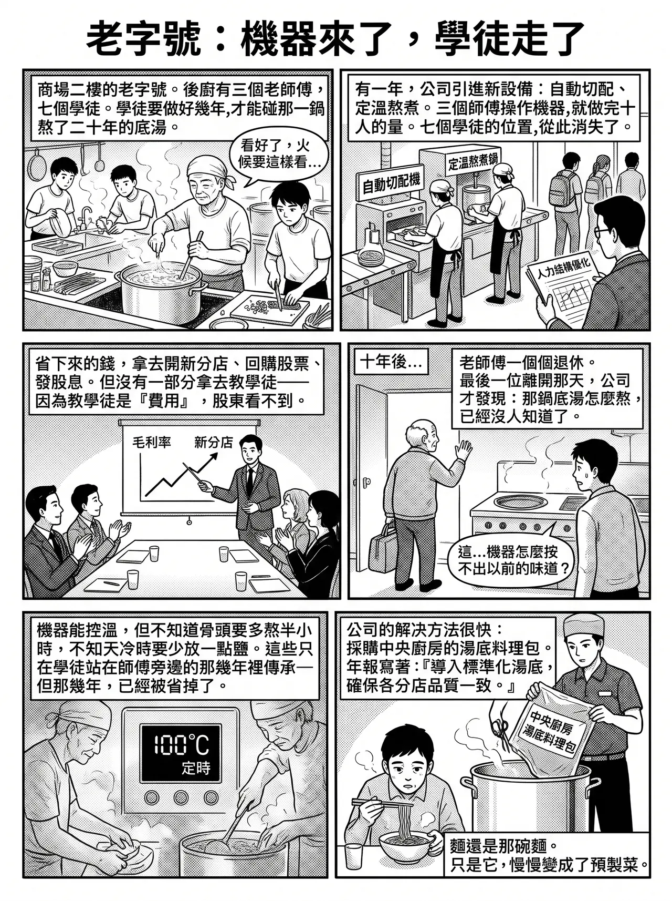
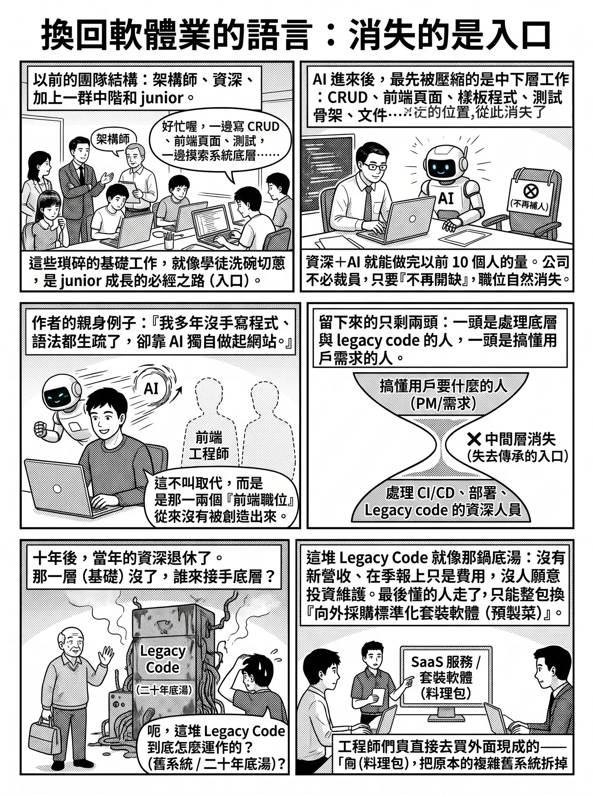

import posterImg from './img/apprentice-gone-poster.webp';

## 一句提示做不出產品，但三個人做得出

<video src="/video/apprentice-gone.mp4" poster={posterImg} controls muted playsInline preload="metadata" width="100%" />

最近在一個技術社群的貼文底下，看到一場很典型的爭論。貼文說：如果有人宣稱你的產品「一個提示就能取代」，千萬別信，你只是賺不到極少數會自己動手的人的錢而已。底下的工程師紛紛附和：CI/CD、軟體簽名、自建 runner，光是這些就能把人搞死，哪有一句提示詞做得完的產品。

他們說得對。不會寫程式的人，確實做不出一個大型、完整、能長期維護的產品。

但這場爭論的兩邊都站得太極端。一邊說 AI 會取代一切，另一邊說 AI 什麼都取代不了。真正在發生的事在中間，而且不太有人想講：**產品不需要消失，人就可以消失。**

一個有經驗的工程師配上 AI，就能做完以前一整組人的工作。產品還在，用戶照樣付錢，消失的是那些本來要請的位置。

我在[〈會開發 AI 的人被裁，會推廣 AI 的人留下〉](/docs/notes/ai-title-game)裡寫過商場三樓那間餐廳。這次講同一個商場的另一間店。

## 二樓那間老字號：機器來了，學徒走了

商場二樓有一間老字號，賣的是一碗湯麵。

它比三樓那間餐廳更早開業，後來做成連鎖，上了市。總店的後廚有十個人：三個老師傅，七個學徒。學徒從洗碗、切蔥做起，幾年後才輪得到碰那鍋熬了二十年的底湯。

有一年，總公司引進了新設備：自動切配機、定溫熬煮鍋、出餐系統。三個老師傅操作機器，就做得完以前十個人的量。

麵還是那碗麵，客人照樣排隊。財務部的報表很好看：人事成本下降，毛利率創新高。

七個學徒的位置，在下一年的編制裡消失了。不是裁員，是不再補人。報表上沒有任何人被開除，只寫著「人力結構優化」。

省下來的錢去了哪裡？

一部分拿去開新分店。新分店的裝潢、設備，都能寫進年報，是「資產」，也是講給股東聽的擴張故事。

一部分拿去回購股票、派發股息。股價漲了，管理層的獎金跟著漲。

沒有一部分拿去教學徒。教學徒的錢是「費用」，當年就從利潤裡扣掉。教出來的學徒，三年後可能被對面那間店挖走。這筆投資的回報，股東看不到，管理層也等不到。

這樣過了十年。

老師傅一個一個退休。最後一位離開那天，公司才發現：那鍋底湯怎麼熬，已經沒有人知道。

機器能控溫，能計時，但不知道哪一批骨頭要多熬半小時，不知道天氣轉冷時鹽要少放一點。這些東西從來沒有寫進任何文件，只在學徒站在師傅旁邊的那幾年裡傳下去。

而那幾年，已經被省掉了。

公司的解決方法很快：向中央廚房採購湯底料理包，就是三樓那間餐廳後來用的那一種。年報寫著：「導入標準化湯底，確保各分店品質一致。」

麵還是那碗麵。只是它從裡面開始，慢慢變成了預製菜。

## 換回軟體業的語言：消失的是入口

二樓的老字號是比喻，結構是軟體業正在發生的事。

一個軟體團隊以前的結構，大概是一個架構師、幾個資深，加上一群中階和 junior。AI 進來之後，最先被壓縮的是中下層的工作：CRUD、前端頁面、樣板程式、測試骨架、文件。

這些工作以前屬於 junior，也是 junior 學東西的地方。他們在寫這些東西的幾年裡，慢慢摸到系統的底層。就像學徒從切蔥做起，幾年後才碰得到底湯。

現在，這一層由資深工程師加 AI 一起做掉了。十個人的團隊變成三個人，產品照樣上線。公司不必裁誰，只要不再開缺。被裁的人看得見，沒開的缺看不見，統計數字也不會記錄。

我自己就是例子。我已經多年沒有手寫程式，語法都生疏了，但靠 AI 照樣把自己的網站做了起來。換在十年前，這個工作量要請一兩個前端。不是我取代了誰，而是那個職位從來沒有出現過。

留下來的是兩頭。一頭是處理底層的人：CI/CD、簽名、部署，還有那堆沒有人敢碰的 legacy code。另一頭是搞清楚用戶到底要什麼的人。

問題在十年後。今天的資深工程師，都是當年從那一層爬上來的。那一層沒了，誰來接手底層？

那堆 legacy code 也一樣。清理它沒有新營收，沒有 demo，在季報上只是成本，所以一直沒有人付錢去做。它就像那鍋底湯：懂的人退休之後，只能整包換掉。

## 為什麼錢流向機器，不流向人

很多人會說，上市公司沒有遠見，不投資未來。這句話只對一半。這幾年，科技公司在 AI 上的資本支出是天文數字，GPU、資料中心一批一批地蓋，錢都是市場給的。

問題不在投不投資，而在股票市場會挑**投資哪一種未來**。

市場獎勵的，是能變成資產、能講成故事的投資。買 GPU、蓋資料中心，在會計上是資本化的，分幾年折舊，當季的每股盈餘不必一次吃掉。它還可以拿去跟投資人說：我們在 AI 領先。

市場懲罰的，是投資在人身上的錢。請 junior、做培訓、清理 legacy code，全部是當期費用，直接壓低盈餘，而且講不出故事。培訓更吃虧：人教出來，跳槽去對手那邊，回報歸別人。

再加上三個機制：

- **季報**讓管理層的時間單位變成三個月。
- **經理人任期**只有幾年，報酬綁著股價和選擇權。一項要十年才回本的投資，收成的時候他早就走了。
- **回購**是把錢交還股東最快的方法，立刻推高股價，比放進一個看不到回報的地方安全。

但不要把帳全部算在「上市」頭上。我家裡以前那盤生意沒有上市，一樣是帳面賺錢、現金收不回來、靠借錢撐到最後。私募基金比上市公司更短視，買下來、切開、賣掉，一刀就完。

更根本的規則是：**做決定的人，如果時間線短於投資的回本期，他就不會投。** 股票市場只是把這條時間線系統性地縮短，讓短視變成一種理性選擇。二樓那間老字號的管理層並不笨，他們只是等不到學徒出師的那一天。

## 我以前相信的效率法則，斷在哪裡

過去十幾二十年，我自己也做過自動化，也一直信一條經濟法則：沒有理由為了保住某些人的工作，而拖慢整個社會的進步。效率提升賺回來的錢，可以拿去照顧被取代的人。賺多了錢，也不必有罪惡感。

這條法則有一個前提：**錢會流回來。**

網路化、自動化本來應該是這樣運作的：省下人力，產出額外的價值，再拿這些價值去填補還沒被滿足的需求。新的行業出現，新的工作出現，東西變便宜，更多人買得起車、買得起房。總的來說，應該有更多人過得更好。

但你看看街邊一碗魚蛋粉。它沒有因為效率提升而變便宜，反而不知道貴了幾倍，品質還變差了。企業賺得更多，全世界也印了更多錢，但這些錢沒有變成人工。

放回二樓那間老字號，這個循環就很清楚：

1. 效率提升，人事成本下降。
2. 省下的錢變成利潤，利潤變成回購、股息和可以入帳的資產。
3. 資產價格上升，握有資產的人先受惠。
4. 人工不升，物價照升，普通人的消費力變弱。
5. 沒有新需求，公司只好再壓成本、再自動化，回到第一步。

效率本身沒有錯。斷掉的是第二步：錢停在資產裡，沒有流回去創造新的需求。如果這些錢留不回到承擔損失的人身上，效率帶來的就不是進步，而是人與人之間的互相廷殺。

## 投資機器的未來，不投資人的未來

所以回到開頭那場爭論：產品會不會被一句提示取代？不會。但這個問題問錯了。

該問的是：做同一個產品需要的人少了，省下來的錢去了哪裡？

答案是去了機器、資產和股東那裡。錢確實有回去投資未來，只是投資機器的未來，不投資人的未來。

二樓那間老字號不會倒閉。它會繼續開分店，繼續派息，年報繼續好看。它失去的只是底湯，和一整代沒有機會站到爐邊的學徒。

裁員會上新聞。沒有開出來的缺，不會。斷掉的不是某一份工作，而是一代人的入口。
